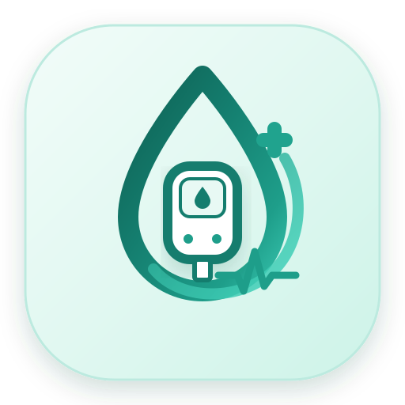

<!--
  README — NetraProof (नेत्रप्रूफ)
  AI-Powered Retinal Screening & Whole-Body Diabetes Health Companion
  Built for: AI Manthan 2.0
  Team: Team AFK
-->

<div align="center">



<br/><br/>

# NetraProof (नेत्रप्रूफ)
### AI-Powered Retinal Screening & Comprehensive Diabetes Health Companion


<br/>

<!-- Badges & Status -->
[](#-the-team--hackathon-credits)
[](#-the-team--hackathon-credits)
[](https://developer.android.com)
[-0D242E?style=for-the-badge&logo=android&logoColor=white)](https://developer.android.com)
[-147D82?style=for-the-badge&logo=android&logoColor=white)](https://developer.android.com)

<br/>

[](https://onnxruntime.ai)
[](https://opencv.org)
[](https://firebase.google.com)
[](https://developer.android.com/training/data-storage/room)
[](https://groq.com)

<br/><br/>

<p align="center">
  <a href="#-executive-summary">Executive Summary</a> •
  <a href="#-the-crisis--clinical-problem-statement">The Crisis</a> •
  <a href="#-netraproof-5-stage-on-device-retinal-diagnostic-suite">Retinal AI Suite</a> •
  <a href="#-diabetes-360-full-body-complications-ecosystem">Diabetes 360</a> •
  <a href="#-medication-intelligence--safety">Medication Safety</a> •
  <a href="#-netra-ai-health-assistant--clinical-rag">AI Assistant</a> •
  <a href="#-profile-settings--data-governance-page-16">Profile & Settings</a> •
  <a href="#-system-architecture">Architecture</a> •
  <a href="#-complete-screen-directory">Screens</a> •
  <a href="#-the-team--hackathon-credits">Team AFK</a>
</p>

</div>

---


## 🩺 Executive Summary

**NetraProof (नेत्रप्रूफ)** is a production-grade, native Android healthcare application engineered for **AI Manthan 2.0** by **Team AFK**.

It transforms mobile phones into **clinical-grade, zero-latency screening stations for Diabetic Retinopathy (DR)**, coupled with **Diabetes 360**—a comprehensive whole-body multi-organ management operating system designed for the **77+ million individuals living with diabetes across India**.

Rather than relying on brittle cloud connections, NetraProof deploys **100% on-device AI pipelines** powered by **ONNX Runtime Mobile (ARM64/ARM32)** and **OpenCV**:
1. **Stage 01:** High-Resolution Fundus Image Acquisition with EXIF validation.
2. **Stage 02:** Optical Quality Assessment Gate with automated anti-spoofing and non-eye image rejection.
3. **Stage 03:** On-device **EfficientNet-B5** with Ordinal Regression for clinical DR severity grading (ICDR Grades 0–4) in **~180–350ms**.
4. **Stage 04:** **U-Net + SE-ResNeXt50** pixel segmentation isolating Microaneurysms, Hemorrhages, Hard Exudates, and Cotton Wool Spots in **~1.2s**.
5. **Stage 05:** Publication-grade, cryptographically verified **AI Retinal Screening PDF Report**.
6. **Diabetes 360:** Targeted monitoring for Diabetic Nephropathy (eGFR/uACR), Cardiovascular Risks (BP & live ECG), Peripheral Neuropathy (tactile monofilament tests & DFU risk), and Glycemic Trajectory (90-day estimated HbA1c curves).

---


## 💔 The Crisis & Clinical Problem Statement

<div align="center">

</div>

<br/>

### 📉 The Real-World Dilemma in India

| Critical Healthcare Bottleneck | Real-World Impact Across Bharat | The NetraProof Solution |
| :--- | :--- | :--- |
| **Silent Vision Loss** | Diabetic Retinopathy silently damages retinal capillaries; patients present only when vision loss is irreversible. | **Automated on-device AI** detects early microvascular lesions before clinical symptoms appear. |
| **Specialist Scarcity** | Fewer than 25,000 ophthalmologists for 1.4B people (>70% in Tier-1 cities). Rural PHCs have zero eye doctors. | **Transforms low-cost Android smartphones** into mobile, frontline ophthalmic diagnostic hubs. |
| **Connectivity & Privacy Barriers** | Cloud AI requires 30MB+ uncompressed uploads, failing on rural 2G/3G networks and leaking biometrics. | **100% offline INT8 ONNX inference (<350ms)** with zero data leaving the handset. |
| **Fragmented Diabetic Care** | Diabetes attacks retina, kidneys, heart, and nerves concurrently; standard apps track isolated glucose only. | **Diabetes 360** unifies multi-organ tracking (eGFR, ECG, neuropathy, HbA1c) in one OS. |

<br/>

### 💡 Why NetraProof Outperforms Existing Solutions

| Dimension | Generic Health Apps | Cloud Diagnostic APIs | **NetraProof (Team AFK)** |
| :--- | :---: | :---: | :---: |
| **Retinal Screening** | ❌ None | Cloud Upload Only | **✅ 100% On-Device AI (EfficientNet-B5 INT8)** |
| **Quality Gate** | ❌ No | Basic Resolution | **✅ Optical Gate + Anti-Spoof Rejection** |
| **Lesion Segmentation** | ❌ No | Static Heatmaps | **✅ Pixel Masks (SE-ResNeXt50 U-Net INT8)** |
| **Multi-Organ Care** | Record logbook | ❌ Isolated | **✅ Diabetes 360 (Eyes, Kidneys, Heart, Feet)** |
| **Offline Operation** | Partial | Needs 4G/WiFi | **✅ Full Room DB + Zero-Cloud AI** |
| **Medication Safety** | Simple timer | ❌ None | **✅ RxNorm + Combinatorial DDI Graph** |
| **Clinical PDF Report** | Basic summary | Paywalled | **✅ Publication-Grade PDF with QR Seal** |

---


## 👁️ NetraProof: 5-Stage On-Device Retinal Diagnostic Suite

> **Zero Cloud Latency • Total Data Sovereignty:** NetraProof runs computer vision models **100% locally on the device** via **ONNX Runtime Mobile (ARM64/ARM32)**. Retinal photographs never leave the smartphone, ensuring complete privacy, zero subscription fees, and reliable operation in rural clinics.

```
   [ Stage 01 ]                [ Stage 02 ]                [ Stage 03 ]               [ Stage 04 ]               [ Stage 05 ]
┌─────────────────┐        ┌──────────────────┐        ┌─────────────────┐        ┌──────────────────┐       ┌──────────────────┐
│  High-Res Fundus│  Pass  │  Optical Quality │  Pass  │  On-Device DR   │  Pass  │  U-Net Lesion    │ Valid │  Publication-Grade│
│   Acquisition   ├───────►│  Assessment Gate ├───────►│  Severity Grader├───────►│  Segmentation   ├──────►│  Clinical PDF    │
│ (Camera/Gallery)│        │ (Clarity/Anti-Spoof)      │ (EfficientNet-B5)       │ (SE-ResNeXt50)   │       │  Screening Report│
│   [Page 02]     │        │    [Page 03]     │        │    [Page 04]    │        │    [Page 05]     │       │    [Page 06]     │
└─────────────────┘        └────────┬─────────┘        └─────────────────┘        └──────────────────┘       └──────────────────┘
                                    │ Fail
                                    ▼
                           [ Rejection with Feedback ]
                           (Too dark, blurry, non-eye)
```

### 1. Stage 01 — Fundus Photograph Acquisition (`RetinaScreeningActivity` · Page 02)
- High-resolution fundus image capture via Android CameraX or Android Storage Access Framework (SAF) gallery picker.
- Validates EXIF orientation, color depth, minimum pixel geometry ($>800\times800$), and patient biometric context association.

### 2. Stage 02 — Optical Quality Assessment Gate (`RetinaQualityAssessmentActivity` · Page 03)
- Real-time pre-inference validation gate preventing degraded or corrupted imagery from reaching the clinical grading engine.
- Evaluates four optical dimensions:
  - **Illumination Uniformity:** Detects uneven flash distribution, shadows, or peripheral vignetting.
  - **Focus Sharpness & Clarity:** Edge-gradient inspection for motion blur or cataract-induced haze.
  - **Field of View (FOV):** Verifies centered macula and optic disc visibility ($>45^\circ$ coverage).
  - **Landmark Integrity:** Validates primary retinal vasculature arcade patterns.
- **Anti-Spoofing & Non-Eye Rejection:** Instantly flags and rejects everyday objects, documents, skin, and non-retinal images with clear feedback.

### 3. Stage 03 — On-Device DR Severity Prediction (`RetinaDrPredictionActivity` · Page 04)
- **Architecture:** Pretrained **EfficientNet-B5** with ordinal regression cut-offs optimized for continuous clinical scoring.
- **Model Footprint:** Compact **27.8 MB INT8 ONNX model** (quantized from 108 MB FP32), running 100% locally on device in **~180–350ms** on mobile CPU/NPU.
- **Input Resolution & Normalization:** 456×456 NCHW tensor, ImageNet mean/std normalized.
- **Ordinal Regression Cutoffs:** `[0.54, 1.62, 2.46, 3.36]` (Referral threshold ≥ 1.62 for Grade 2+).
- **Classification:** Standard 5-tier International Clinical Diabetic Retinopathy (ICDR) scale:
  - 🟢 **Grade 0 — No Apparent DR:** Healthy retinal vasculature; routine annual dilated recall.
  - 🔵 **Grade 1 — Mild NPDR:** Isolated microaneurysms present; 6–12 month monitoring.
  - 🟡 **Grade 2 — Moderate NPDR:** Multiple microaneurysms, dot/blot hemorrhages, venous beading; ophthalmology referral recommended.
  - 🟠 **Grade 3 — Severe NPDR:** $>20$ intraretinal hemorrhages in 4 quadrants, venous beading in 2+ quadrants, or IRMA in 1+ quadrant; prompt clinical intervention.
  - 🔴 **Grade 4 — Proliferative DR (PDR):** Neovascularization, vitreous/preretinal hemorrhage; urgent surgical referral required.
- Enforces strict workflow security: downstream segmentation and reporting remain locked until Stage 03 finishes.

### 4. Stage 04 — Retinal Lesion Segmentation & Interactive Visualization (`RetinaLesionSegmentationActivity` · Page 05)
- **Architecture:** **U-Net** architecture with **SE-ResNeXt50_32x4d** (Squeeze-and-Excitation ResNeXt50) encoder at $512\times512$ resolution.
- **Model Footprint:** Compact **33.3 MB INT8 ONNX model** (quantized from 132 MB FP32) executing full pixel inference in **~1.2s** locally with zero cloud memory crashes.
- **Independently Segmented Biomarkers:**
  - 🔴 **Microaneurysms (MA):** Focal capillary outpouchings indicating early endothelial breakdown.
  - 🟠 **Hemorrhages (HEM):** Ruptured microvessels leaking into retinal layers.
  - 🟡 **Hard Exudates (EX):** Waxy lipid and protein deposits from chronically hyper-permeable capillaries.
  - ⚪ **Cotton Wool Spots (CWS):** Nerve fiber layer ischemic micro-infarctions.
- **Interactive Multi-Layer Visualization (`RetinaOverlayView`):**
  - Smooth alpha-opacity slider (10% to 100%).
  - Independent layer visibility toggles (Show All / Individual Mask Inspection).
  - High-precision pinch-to-zoom and pan canvas with side-by-side comparative split mode.

### 5. Stage 05 — Publication-Grade Clinical Screening Report (`RetinaScreeningReportActivity` · Page 06)
- Vectorized clinical PDF compiler (`RetinaReportPdfGenerator`) formatted for hospital records.
- Embeds patient demographics, fundus photographs, segmented lesion masks, severity grade, clinical referral urgency, and a tamper-evident QR verification seal.
- Direct export and secure sharing via Android `FileProvider`.

---


## 🩺 Diabetes 360: Full-Body Complications Ecosystem

Diabetes is a systemic microvascular disease that damages multiple organ systems simultaneously. The **Diabetes 360 Hub (`Diabetes360DashboardActivity` · Page 07)** provides organized, clinical-grade overview tracking across all vital domains:

```
                                  ╔═══════════════════════════╗
                                  ║   DIABETES 360 DASHBOARD  ║
                                  ╚═══════════════════════════╝
                                                │
         ┌──────────────────────┬───────────────┴───────────────┬──────────────────────┐
         ▼                      ▼                               ▼                      ▼
  👁️ Retinal Health      🫘 Kidney Health               ❤️ Heart & Vascular    🦶 Foot & Nerves
  • NetraProof AI       • eGFR Tracking (CKD-EPI)      • Systolic / Diastolic  • Monofilament Test
  • Lesion Masks        • Urine Albumin-Creatinine     • Live ECG Waveform     • Vibration Perception
  • ICDR Severity       • Microalbuminuria Alerts      • CAD Microvascular     • Ulcer Risk Visualizer
```

| Module | Activity | Core Clinical Metrics & Capabilities |
|:---|:---|:---|
| **👁️ Retinal Health** | `RetinaScreeningActivity` | Fundus screening, lesion mapping, ICDR grading, ophthalmology guidance. |
| **🫘 Kidney Health** | `KidneyHealthActivity` | eGFR calculation (CKD-EPI equation), urine Albumin-to-Creatinine Ratio (uACR), KDIGO CKD risk staging. |
| **❤️ Heart & Vascular** | `HeartHealthActivity` | Blood pressure monitoring, Mean Arterial Pressure (MAP), live interactive ECG canvas (`LiveEcgView`), CAD risk indicators. |
| **🦶 Foot & Nerve Care** | `FootNerveCareActivity` | Monofilament tactile test scoring, vibration perception tracking, diabetic foot ulcer (DFU) risk visualization. |
| **🩸 Glucose & HbA1c** | `GlucoseHba1cTrackingActivity` | Fasting, post-prandial, random glucose logs, 90-day estimated HbA1c curves, hyper/hypoglycemia flags. |

---


## 💊 Medication Intelligence & Safety

```
  [ Pill Strip / Rx ] ──► [ OpenCV Clean ] ──► [ Multi-Pass OCR ] ──► [ RxNorm Normalize ]
                                                                             │
    ┌────────────────────────────────────────────────────────────────────────┘
    ▼
  [ Graph DDI Check ] ──► [ Jan Aushadhi Savings ] ──► [ NLP Schedule Engine ] ──► [ Full-Screen Alarm ]
  (ddi_graph + FDA)        (Generic Alternative + GPS)   ("2 tabs BD pc" -> Cron)    (Lockscreen Overlay)
```

1. **3-Pass Hybrid Edge OCR (`MedicationOcrActivity`):**
   - OpenCV adaptive binarization, contrast adjustment, and noise filtering (`org.opencv:opencv:4.10.0`).
   - Primary text extraction with Google ML Kit On-Device Text Recognition v16.0.0; fallback to embedded Tesseract (`tess-two`).
2. **RxNorm Indian Brand Normalization:**
   - Maps trade names (e.g., *Crocin 650*, *Dolo 650*, *Glycomet*, *Ecosprin*) into active chemical entities (*Paracetamol*, *Metformin Hydrochloride*, *Aspirin*).
3. **Combinatorial Drug-Drug Interaction (DDI) Graph:**
   - Evaluates an $N \times (N-1)$ combinatorial interaction matrix across all active patient prescriptions.
   - Categorizes interactions into 🔴 Contraindicated (Blocked), 🟡 Moderate Warning, and 🟢 Safe.
4. **Jan Aushadhi Affordable Generic Price Comparison:**
   - Compares brand-name prescription costs against certified Jan Aushadhi generic equivalents, showing up to **85% savings** with nearest Kendra GPS directions.
5. **NLP Schedule Engine & Lock-Screen Alarms (`MedicationAlarmActivity`):**
   - Converts natural doctor instructions into exact Android `AlarmManager` and `WorkManager` triggers with custom high-priority audio (`medication_reminder.mp3`).

---


## 🤖 Netra AI Health Assistant & Clinical RAG (`NetraAiAssistantActivity` · Page 13)

> Contextual conversational intelligence designed specifically for chronic disease and diabetic education.

- **Hybrid Edge/Cloud Architecture:**
  - **Cloud Reasoning:** Ultra-fast **Groq API** utilizing **LLaMA 3.3 70B Versatile** and **LLaMA 3.1 8B Instant**.
  - **On-Device Edge:** Native **Google AI Edge / AICore (Gemini Nano)** for private offline execution.
  - **Offline Fallback:** Local heuristic clinical decision engine (`ClinicalIntelligenceEngine`).
- **Zero-Cost Document RAG Pipeline:**
  - Ingests uploaded medical reports, discharge summaries, and lab test PDFs via `pdfbox-android`.
  - Performs local boundary-aware text chunking (`HealthDocumentChunkEntity`).
  - Synthesizes contextual patient answers grounded directly in the user's authentic medical history.

---


## ⚙️ Profile, Settings & Data Governance (`NetraProfileSettingsActivity` · Page 16)

The central management hub for account, personal demographics, preferences, privacy, and security:

- **Profile Overview & Demographics:** Real authenticated patient information, verified ID (`ID: NP-XXXXXX`), profile photo or initials badge, date of birth, age, gender, blood group, and emergency contacts.
- **Application Preferences:** Language selection (English, Hindi / हिन्दी), Blood Glucose Unit toggle (**`mg/dL`** vs **`mmol/L`**), Theme selector (System Default, Light, Dark via `AppCompatDelegate`), and Date format preferences.
- **Notification Preferences (Page 14 Engine):** System notification permission diagnostics with direct route to device settings; granular toggles for Glucose reminders, Prescription doses, Retinal recalls, and Kidney/Foot checks.
- **Privacy & Data Governance:** Comprehensive local-first privacy policy, investigational clinical disclosures, anonymous model telemetry toggle, and one-tap **Export My Health Data** generating a complete structured JSON dossier.
- **Security & Destructive Actions:** Hardware-backed Keystore AES-256 encryption specs, biometric app lock, secure logout, and safeguarded two-step **Erase All Data & Reset Profile** wipe.

---


## 🏗️ System Architecture

```
                                    ┌────────────────────────────────────┐
                                    │     NETRAPROOF CLIENT (ANDROID)    │
                                    │      Java 11 · SDK 34 · Material 3 │
                                    └─────────────────┬──────────────────┘
                                                      │
         ┌───────────────────────────┬────────────────┴───────────────────────────┬───────────────────────────┐
         ▼                           ▼                                            ▼                           ▼
┌──────────────────┐       ┌────────────────────┐                       ┌───────────────────┐       ┌───────────────────┐
│ ON-DEVICE AI     │       │ LOCAL STORAGE      │                       │ CLOUD INTEGRATION │       │ CLINICAL RAG      │
│ (Zero-Latency)   │       │ (Offline-First)    │                       │ (Real-Time Sync)  │       │ (Hybrid Intel)    │
├──────────────────┤       ├────────────────────┤                       ├───────────────────┤       ├───────────────────┤
│ • ONNX Grader    │       │ • Room DB (v19)    │                       │ • Firebase Auth   │       │ • Groq LLaMA 3.3  │
│   (EfficientNet) │       │   14 Entities      │                       │ • Cloud Firestore │       │ • Gemini Nano     │
│ • ONNX U-Net     │       │ • EncryptedPrefs   │                       │ • Firebase FCM    │       │ • PDFBox Android  │
│   (SE-ResNeXt50) │       │   (AES-256-GCM)    │                       │ • Cloudinary      │       │ • RxNorm & FDA    │
│ • ML Kit OCR     │       │ • Local JSON DBs   │                       │ • Socket.IO Client│       │ • Jan Aushadhi    │
│ • OpenCV Vision  │       │   (DDI / Drugs)    │                       │ • OpenStreetMap   │       │   Kendra Locator  │
└──────────────────┘       └────────────────────┘                       └───────────────────┘       └───────────────────┘
```

---


## 📱 Complete Screen Directory

The application consists of **16+ specialized Activities and Components** engineered with clean UI, unified top navbar profile header, and sticky floating bottom navigation:

| Page # | Screen / Component | Class | Key Functionality |
|:---:|:---|:---|:---|
| **01** | **Onboarding Funnel** | `Step1BasicInfoActivity`<br/>`Step1bEmergencyContactsActivity`<br/>`Step2MedicalHistoryActivity`<br/>`Step3VerifyResumeActivity` | Multi-step progressive patient profiling: demographics, baseline vitals, chronic diagnoses, verified contacts. |
| **02** | **Retina Screening Entry** | `RetinaScreeningActivity` | NetraProof Stage 01: Fundus photo acquisition, SAF file picker, CameraX image capture, metadata binding. |
| **03** | **Optical Quality Gate** | `RetinaQualityAssessmentActivity` | NetraProof Stage 02: Real-time optical clarity inspection, illumination analysis, and non-eye image rejection. |
| **04** | **DR Severity Prediction** | `RetinaDrPredictionActivity` | NetraProof Stage 03: On-device EfficientNet-B5 INT8 inference, continuous ordinal scoring, ICDR 0-4 grade assignment. |
| **05** | **Lesion Segmentation** | `RetinaLesionSegmentationActivity` | NetraProof Stage 04: U-Net SE-ResNeXt50 pixel overlay, alpha slider, lesion layer toggles (MA, HEM, EX, CWS). |
| **06** | **AI Screening Report** | `RetinaScreeningReportActivity` | NetraProof Stage 05: Official diagnostic PDF report compilation, QR cryptographic verification, and sharing. |
| **07** | **Diabetes 360 Hub** | `Diabetes360DashboardActivity` | Centralized multi-organ complications status, upcoming health reminders, and biomarker summaries. |
| **08** | **Kidney Health** | `KidneyHealthActivity` | eGFR tracking via CKD-EPI equation, urine albumin-creatinine ratio (uACR), and renal preservation tips. |
| **09** | **Heart & Vascular Health** | `HeartHealthActivity` | Blood pressure analytics, live interactive ECG waveform canvas (`LiveEcgView`), and CAD microvascular risks. |
| **10** | **Foot & Nerve Care** | `FootNerveCareActivity` | Monofilament sensory test tracking, peripheral neuropathy assessment, and ulcer risk visualization. |
| **11** | **Glucose & HbA1c** | `GlucoseHba1cTrackingActivity` | Glycemic log book, 90-day estimated HbA1c trajectory curves, meal tag correlations, and target ranges. |
| **12** | **Main Command Dashboard** | `DashboardActivity`<br/>`MedicationSafetyHomeFragment` | Central dashboard with quick actions, adherence rings, active alerts, and seamless bottom tab navigation. |
| **13** | **Netra AI Assistant** | `NetraAiAssistantActivity` | Conversational RAG assistant powered by Groq LLaMA 3.3 70B, on-device Gemini Nano, and PDFBox extraction. |
| **14** | **Notifications & Reminders** | `NotificationsRemindersActivity` | Unified scheduling hub for doses, retinal recalls, kidney tests, and foot checks with sound alerts. |
| **15** | **Medication OCR & Alarms** | `MedicationOcrActivity`<br/>`MedicationAlarmActivity` | 3-pass hybrid OCR review screen, DDI matrix, Jan Aushadhi generic comparison, and lockscreen alarms. |
| **16** | **Profile & Settings** | `NetraProfileSettingsActivity` | Account overview, demographic edits, app preferences (units, language, theme), privacy, dossier export, security. |

---


## ⚙️ Tech Stack

<div align="center">

| Domain | Technology / Library | Version | Role in NetraProof |
|:---|:---|:---:|:---|
| **Language & Platform** | Java 11 / Android SDK | 34 (Target), 31 (Min) | 100% Native Android platform code |
| **On-Device Vision AI** | ONNX Runtime Mobile | `1.17.0` | Local EfficientNet DR grading & U-Net lesion segmentation |
| **Computer Vision** | OpenCV Android SDK | `4.10.0` | Fundus contrast equalization, OCR image preprocessing |
| **OCR Engines** | Google ML Kit + Tesseract | `16.0.0` / `9.1.0` | Multi-pass pill bottle & prescription text extraction |
| **Edge & Cloud LLM** | Groq Cloud + Google AICore | `3.3 70B` / `0.0.1-exp02` | RAG clinical assistant & schedule parser |
| **Local Persistence** | Android Room DB | `2.6.1` (v19) | 14 relational entities, offline-first data cache |
| **Cloud Backend** | Firebase (Auth, Firestore, FCM) | `22.3` / `24.10` / `23.4` | User identity, real-time sync, and emergency push alerts |
| **Media Storage** | Cloudinary Android SDK | `2.3.1` | Medical reports and encrypted fundus photo backup |
| **Document Processing**| Apache PDFBox for Android | `2.0.27.0` | Zero-cost medical lab report text extraction |
| **Mapping & Location** | Google Play Services + OSMDroid | `21.0.1` / `6.1.18` | GPS emergency pings, doctor search & Jan Aushadhi finder |
| **Security** | AndroidX Security Crypto | `1.1.0-alpha06` | EncryptedSharedPreferences (AES256-GCM / MasterKey) |
| **Networking** | Retrofit 2 + OkHttp 3 | `2.9.0` / `4.11.0` | REST API communications with interceptors |
| **QR Code Engine** | ZXing Core + Embedded | `3.5.0` / `4.3.0` | Diagnostic report cryptographic QR verification |
| **Background Tasks** | Android WorkManager | `2.9.0` | Periodic screening recalls, background synchronization |

</div>

---


## 🚀 Installation & Build Instructions

### 1. Prerequisites
- **Android Studio:** Hedgehog (2023.1.1) or newer (Jellyfish, Koala, Ladybug).
- **Java Development Kit:** JDK 11 (or OpenJDK 17 configured in Android Studio).
- **Android SDK:** Platform 34 (Android 14) installed with Build-Tools `34.0.0`.
- **Physical Device / Emulator:** Running Android 12+ (API 31+). *A physical device with a camera is recommended for retinal screening and OCR.*

### 2. Clone the Repository
```bash
git clone https://github.com/shreyanshsharma-1210/NetraProof-Team-AFK.git
cd NetraProof-Team-AFK
```

### 3. Configure Local Properties & API Keys
Create or edit `local.properties` in the project root:
```properties
sdk.dir=/path/to/your/Android/Sdk

# Groq Cloud API Key for Netra AI Assistant RAG
GROQ_API_KEY=gsk_your_groq_api_key_here
```

### 4. Build and Deploy
```bash
# Clean and assemble debug APK
./gradlew assembleDebug

# Install directly onto connected ADB device
./gradlew installDebug
```

---


## ⚠️ Clinical & Legal Disclaimer

> [!IMPORTANT]
> **NetraProof is an investigational clinical decision-support and assistive screening tool, NOT a standalone medical diagnostic device.**
> 
> The predictions, severity scores, and lesion segmentations generated by NetraProof's on-device AI are intended solely to assist healthcare professionals and empower patients to seek timely ophthalmological evaluation. They do not replace a formal dilated fundus examination performed by a board-certified ophthalmologist or optometrist.
> 
> Medication schedules and interaction warnings are compiled from open pharmacological resources (RxNorm, OpenFDA, PMBJP) and must be corroborated with the prescribing physician. Never alter prescription dosages without licensed medical supervision.

---


## 👥 The Team & Hackathon Credits

Built with pride by **Team AFK** for **AI Manthan 2.0**:

<div align="center">

### 🏆 **AI Manthan 2.0**
#### Healthcare & Artificial Intelligence Track

<br/>

### 👥 **Team AFK**

| # | Member Name | Role / Focus |
|:---:|:---|:---|
| **1** | **Shreyansh Sharma** | AI Architecture & Pipeline Integration |
| **2** | **Somil Jain** | Android Engineering & System Architecture |
| **3** | **Aditi Rajput** | Medical Workflow, UI/UX & Clinical Design |
| **4** | **Mahima Jain** | Computer Vision Models & Data Research |

<br/>


<br/>

*Dedicated to the 77+ million individuals and families living with diabetes across India who deserve accessible, on-device healthcare intelligence.*

<br/>

[](#)
[](#)

</div>
