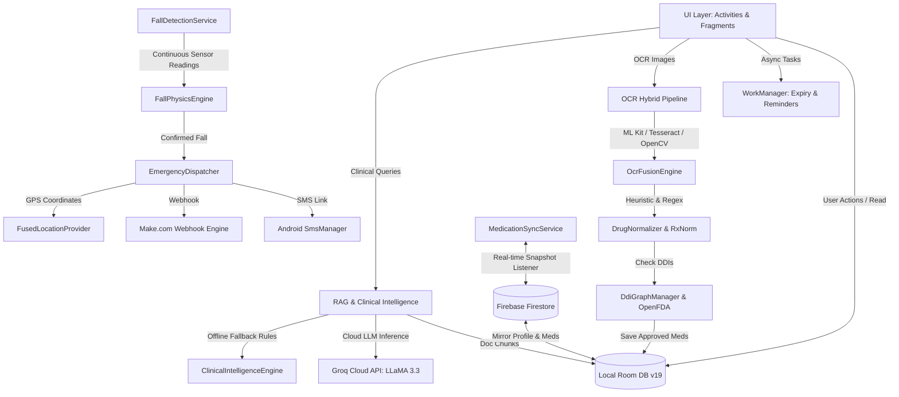
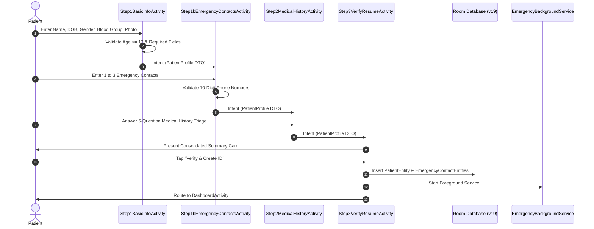
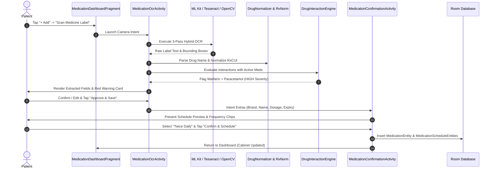
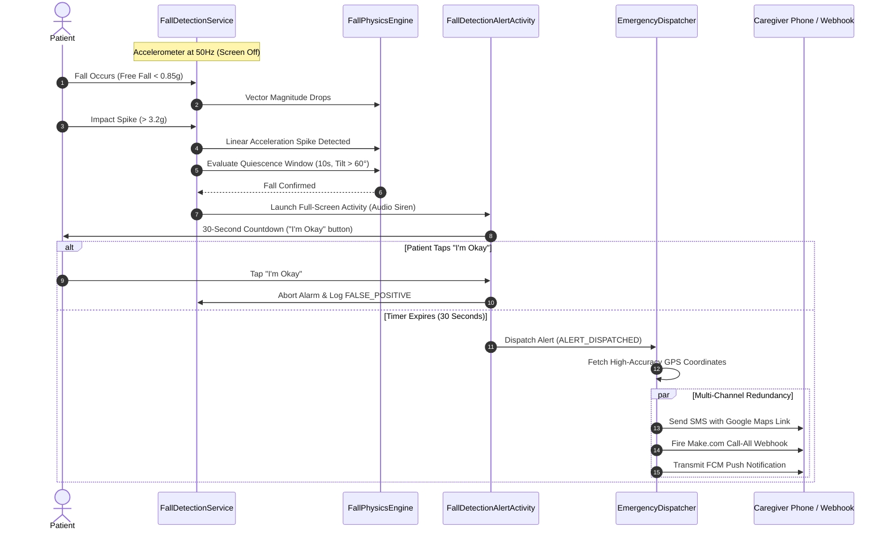

# COMPLETE PROJECT ANALYSIS REPORT: SANJEEVANI (संजीवनी)
**Personal Health Operating System & Intelligent Medication Safety Platform**

---

## Document Control & Metadata

| Attribute | Details |
|:---|:---|
| **Project Name** | Sanjeevani (संजीवनी) — Personal Health OS |
| **Originating Hackathon** | Innovik 6.0 (Healthcare Technology Track) |
| **Award / Status** | Hackathon Build / Production Prototype |
| **Team** | Quad Binary |
| **Problem Statement** | PS2 — Medication Interaction & Expiry Tracker (Extended to Personal Health OS) |
| **Target Platform** | Native Android (Java 11, Min SDK 31 Android 12, Target SDK 34 Android 14) |
| **Local Database Engine** | Room Persistence Library v2.6.1 (Schema Version 19) |
| **Cloud Services** | Firebase (Auth, Firestore, Cloud Messaging), Cloudinary Media Storage |
| **Edge & Cloud AI** | Groq Compound Cloud Inference (LLaMA 3.3 70B & 3.1 8B), On-Device AICore (Gemini Nano) |
| **Computer Vision / OCR** | Multi-Pass Hybrid: Google ML Kit Text Recognition v16.0.0 + Tesseract OCR (tess-two v9.1.0) + OpenCV Android v4.10.0 |
| **Document Date** | October 2026 |
| **Analysis Authority** | Senior AI Software Architect & System Auditor |
| **Target Audience** | Engineering Leads, AI Coding Agents, Mobile Developers, Medical Systems Architects |

---

## Table of Contents

1. [Chapter 1 — Executive Summary](#chapter-1--executive-summary)
2. [Chapter 2 — Project Overview and Purpose](#chapter-2--project-overview-and-purpose)
3. [Chapter 3 — Complete Project Directory Structure](#chapter-3--complete-project-directory-structure)
4. [Chapter 4 — Technology Stack and Dependencies](#chapter-4--technology-stack-and-dependencies)
5. [Chapter 5 — Application Architecture](#chapter-5--application-architecture)
6. [Chapter 6 — Complete Page-by-Page UI Analysis](#chapter-6--complete-page-by-page-ui-analysis)
7. [Chapter 7 — Complete Design System](#chapter-7--complete-design-system)
8. [Chapter 8 — Complete Button Inventory](#chapter-8--complete-button-inventory)
9. [Chapter 9 — All Interactive Elements and Their Functionality](#chapter-9--all-interactive-elements-and-their-functionality)
10. [Chapter 10 — Complete Feature-by-Feature Documentation](#chapter-10--complete-feature-by-feature-documentation)
11. [Chapter 11 — User Roles and Permissions](#chapter-11--user-roles-and-permissions)
12. [Chapter 12 — User Journeys and Workflow Diagrams](#chapter-12--user-journeys-and-workflow-diagrams)
13. [Chapter 13 — Frontend Component Architecture](#chapter-13--frontend-component-architecture)
14. [Chapter 14 — Backend Architecture](#chapter-14--backend-architecture)
15. [Chapter 15 — Complete API Documentation](#chapter-15--complete-api-documentation)
16. [Chapter 16 — Database Schema and Relationships](#chapter-16--database-schema-and-relationships)
17. [Chapter 17 — Authentication and Authorization](#chapter-17--authentication-and-authorization)
18. [Chapter 18 — Forms, Fields and Validation Rules](#chapter-18--forms-fields-and-validation-rules)
19. [Chapter 19 — Responsive Design Analysis](#chapter-19--responsive-design-analysis)
20. [Chapter 20 — Accessibility Analysis](#chapter-20--accessibility-analysis)
21. [Chapter 21 — Images, Icons, Fonts and Other Assets](#chapter-21--images-icons-fonts-and-other-assets)
22. [Chapter 22 — Animations and Transitions](#chapter-22--animations-and-transitions)
23. [Chapter 23 — Error Handling and Notifications](#chapter-23--error-handling-and-notifications)
24. [Chapter 24 — Complete Testing and Functional Status](#chapter-24--complete-testing-and-functional-status)
25. [Chapter 25 — Bugs, Limitations and Technical Debt](#chapter-25--bugs-limitations-and-technical-debt)
26. [Chapter 26 — Performance and Security Observations](#chapter-26--performance-and-security-observations)
27. [Chapter 27 — Reusable Components and Modules](#chapter-27--reusable-components-and-modules)
28. [Chapter 28 — Old Project vs New Project Modification Blueprint](#chapter-28--old-project-vs-new-project-modification-blueprint)
29. [Chapter 29 — Recommended Migration and Modification Sequence](#chapter-29--recommended-migration-and-modification-sequence)
30. [Chapter 30 — Final Technical Recommendations](#chapter-30--final-technical-recommendations)

---

# Chapter 1 — Executive Summary

### 1.1 High-Level Vision
**Sanjivani (संजीवनी)** is a native Android Personal Health Operating System engineered to eradicate preventable medical crises arising from fragmented polypharmacy, uncoordinated specialist care, silent physiological deterioration, and catastrophic falls among chronic patients and the elderly. Built under the Innovik 6.0 hackathon initiative by Team Quad Binary, the platform addresses **Problem Statement 2 (Medication Interaction & Expiry Tracker)** while expanding outward into a cohesive, five-layer healthcare nexus.

### 1.2 The Core Problem
In India, over **230 million individuals aged 50 and above** manage multiple chronic morbidities (hypertension, Type 2 diabetes mellitus, dyslipidemia, coronary artery disease, thyroid disease). The typical elderly patient consults an average of 3.2 distinct medical specialists who operate in functional silos without unified electronic health record (EHR) visibility. Adverse Drug Reactions (ADRs) account for 3% to 5% of all hospital emergency admissions in developing nations—equating to a preventable clinical emergency every 90 seconds. Existing applications fail categorically because reminder apps remain blind to pharmacological interactions, storage portals lack active triage engines, and generic trackers fail to correlate sudden vital deviations with newly introduced drugs.

### 1.3 The Technical Solution
Sanjivani solves this disconnection through a tightly coupled hardware-software and on-device/cloud intelligence architecture:
1. **Multi-Pass OCR & Edge Drug Normalization:** Captures pill bottles, strips, and packaging via Google ML Kit Text Recognition and Tesseract OCR with OpenCV image enhancement, normalizing commercial Indian and global trade brand names (e.g., Crocin, Dolo 650, Calpol) into canonical RxNorm generic active ingredients (Acetaminophen / Paracetamol).
2. **Local & Cloud Drug-Drug Interaction (DDI) Graph:** Evaluates new medication inputs against the entire patient pharmacological profile using an offline graph engine (`ddi_graph.json`) backed by OpenFDA query integration.
3. **Continuous IoT Telemetry & Fall Detection:** Interfaces with wearable sensors (ESP32 Gateway via BLE/Wi-Fi) to stream live photoplethysmography (SpO2, Heart Rate) and body temperature, while maintaining an autonomous DSP physics engine that detects free-fall, high-G impact spikes, and post-impact immobility directly on the device accelerometer.
4. **Resilient Emergency Dispatch & Medical ID:** Generates an un-lockable emergency screen with dynamic QR code encoding patient credentials and health history, paired with automated multi-channel alert dispatch (SMS, Make.com webhooks, FCM) and real-time OpenStreetMap/OSRM ambulance navigation.
5. **Luna Women's Health & Cycle Intelligence:** An integrated female health module calculating hormonal fluctuations, basal body temperature (BBT) shifts, and cycle-phase pharmacological contraindications.
6. **Zero-Cost On-Device & Cloud RAG:** Extracts medical records using PDFBox Android, chunks text locally with boundary-preserving algorithms, and synthesizes answers via Groq Cloud LLM (LLaMA 3.3 70B Versatile / LLaMA 3.1 8B Instant) with on-device fallback rule-based clinical intelligence.

### 1.4 Architecture Summary
The codebase is developed in 100% native Java 11 targeting Android SDK 34. Data persistence utilizes an offline-first Room database (14 entities, 12 DAOs, schema version 19), with selective cloud mirroring via Firebase Firestore and Cloudinary media buckets. Critical safety services run as Android Foreground Services (`specialUse` and `health` types) with partial CPU wake-locks and battery optimization bypasses to guarantee 24/7 background survivability.

---

# Chapter 2 — Project Overview and Purpose

### 2.1 Clinical & Social Context
Indian healthcare delivery lacks a universally mandated, real-time shared EHR infrastructure. A patient visiting a cardiologist in Indore for angina may be prescribed Clopidogrel and Aspirin; a week later, an orthopedic surgeon treating degenerative osteoarthritis in the same patient may prescribe Diclofenac or Ibuprofen. When combined, this regimen exponentially escalates gastrointestinal ulceration and life-threatening internal hemorrhage risks.

Sanjivani establishes an authoritative personal health shield on the patient’s own smartphone, enforcing safety checks at the point of ingestion before a pill is swallowed.

### 2.2 The Five Core Layers
Sanjivani organizes its capabilities into five distinct architectural layers:

```
┌────────────────────────────────────────────────────────────────────────┐
│                      SANJIVANI PLATFORM ARCHITECTURE                   │
├───────────────────┬───────────────────┬────────────────────────────────┤
│ 💊 Layer 1        │ 🏥 Layer 2        │ 📡 Layer 3                     │
│ Medication        │ Health Profile    │ IoT Vitals &                   │
│ Intelligence      │ & Resume          │ Safety Engine                  │
│ Engine (PS2)      │ (EHR Backbone)    │ (Sensors & Fall DSP)           │
├───────────────────┴───────────────────┴────────────────────────────────┤
│ 🔴 Layer 4: Emergency Response (Lockscreen SOS, QR, Dispatcher, Maps)   │
├────────────────────────────────────────────────────────────────────────┤
│ 🌙 Layer 5: Luna Cycle Intelligence (Vitals-Aware Women's Health)       │
├────────────────────────────────────────────────────────────────────────┤
│ ☁️ Cloud & Edge: Firebase (Firestore/FCM) · Groq LLM · Room DB (v19)   │
└────────────────────────────────────────────────────────────────────────┘
```

#### Layer 1: Medication Intelligence Engine (PS2 Core)
- **Scanning:** Camera scan of pill packages or bottles.
- **Computer Vision:** ML Kit 3-pass multi-strategy text recognition + offline Tesseract OCR fallback.
- **Normalization:** Translates trade names to generic equivalents via RxNorm REST API and local dictionary (`drug_dictionary.json`).
- **Safety Graph:** OpenFDA label check and on-device directed graph traversal (`ddi_graph.json`) detecting moderate to fatal contraindications.
- **Scheduling:** Natural Language Processing (NLP) extracts dosage frequency, meal dependencies, and administration hours, populating WorkManager exact alarms and Google Calendar events.
- **Adherence & Expiry:** Daily background checks flag approaching drug expiries at 30, 7, and 1 day milestones; full audit logging of TAKE / SNOOZE / DISMISS / MISSED dose states.

#### Layer 2: Health Profile & Medical Resume
- Living, longitudinal clinical dossier consolidating verified onboarding information, chronic triage classifications, uploaded lab PDFs, medication regimens, and doctor consultation notes.
- Serves as the grounded context window for the RAG health assistant and populates the emergency QR code endpoint.

#### Layer 3: IoT Vitals & Safety Engine
- Receives physiological metrics from an ESP32 hardware patch (MAX30102 for SpO2 and Heart Rate; DS18B20 for skin temperature).
- Continuous correlation engine checks whether vital anomalies (e.g., sudden tachycardia of 147 BPM) align with a medication ingested 2 to 6 hours prior.
- Autonomous smartphone accelerometer fall detection operating through a 3-phase physics state machine.

#### Layer 4: Emergency Response
- Accessible immediately over lockscreen without PIN/biometric challenge.
- Single-motion emergency slider triggers a 3-second abortable countdown before firing multi-channel alerts (SMS with Google Maps GPS link, Make.com webhook automation, FCM notification to guardians).
- OSMDroid map with Project-OSRM road network routing displaying real-time simulated or live ambulance progress.

#### Layer 5: Luna Cycle Intelligence
- Women's health system correlating physiological telemetry with menstrual cycle phases (Menstrual, Follicular, Ovulation, Luteal).
- Features on-device clinical contradiction database (`ContraDatabase.java`) alerting against drugs that compromise cycle regularity, hormonal balance, or contraceptive efficacy.

---

# Chapter 3 — Complete Project Directory Structure

```
d:\Projects\diabetic-sanjeevani\
├── .git/                                   # Git revision control directory
├── .gradle/                                # Gradle operational cache
├── app/                                    # Application Module
│   ├── build.gradle                        # App build configuration, dependencies, keys
│   ├── proguard-rules.pro                  # R8 Proguard code obfuscation and retention rules
│   └── src/
│       ├── test/java/com/emergency/patient/
│       │   ├── scheduling/
│       │   │   └── DosageParserTest.java   # Unit tests for NLP dosage string parsing
│       │   └── services/
│       │       └── FallDetectionPhysicsTest.java # Unit tests for accelerometer DSP math
│       └── main/
│           ├── AndroidManifest.xml         # Manifest: permissions, activities, services, receivers
│           ├── assets/                     # Packaged static knowledge and OCR datasets
│           │   ├── ddi_graph.json          # Directed graph of drug interaction node/edges
│           │   ├── drug_dictionary.json    # Trade brand to generic active ingredient map
│           │   ├── hard_override.json      # Priority multi-keyword overrides for OCR
│           │   ├── interaction_dataset.json# Canonical drug-to-drug severity database
│           │   ├── ocr_overrides.json      # OCR spell-correction dictionary
│           │   ├── pattern_knowledge.json  # Multi-token boost rules for known packaging
│           │   └── tessdata/
│           │       └── eng.traineddata     # Tesseract OCR English neural network trained data
│           ├── java/com/emergency/patient/
│           │   ├── activities/             # UI Activities and Fragments
│           │   │   ├── AdherenceRingView.java              # Custom circular progress ring view
│           │   │   ├── ChatWebViewFragment.java            # Embedded WebView for caregiver messaging
│           │   │   ├── DashboardActivity.java              # Main host activity & floating navigation shell
│           │   │   ├── DocumentUploadActivity.java         # Document picker, preview and cloud upload
│           │   │   ├── EditProfileActivity.java            # Profile editing activity
│           │   │   ├── EmergencyActiveActivity.java        # Live SOS monitoring dashboard with OSM map
│           │   │   ├── FallDetectionAlertActivity.java     # Full-screen lockscreen siren & 30s countdown
│           │   │   ├── HealthAssistantFragment.java        # Conversational RAG AI chatbot
│           │   │   ├── HealthResumeFragment.java           # Comprehensive medical resume tab
│           │   │   ├── IotEcgBottomSheet.java              # Full-screen bottom sheet with live ECG monitor
│           │   │   ├── ManageEmergencyContactsActivity.java# Emergency contacts CRUD manager
│           │   │   ├── MedicalIdFragment.java              # Emergency QR card and profile tab
│           │   │   ├── MedicationConfirmationActivity.java # Medication schedule preview & frequency chips
│           │   │   ├── MedicationDashboardFragment.java    # Cabinet inventory, timeline and date picker
│           │   │   ├── MedicationOcrActivity.java          # Multi-image OCR review and approval
│           │   │   ├── MedicationSafetyHomeFragment.java   # Central command dashboard with live cards
│           │   │   ├── QuickAccessActivity.java            # Lockscreen Medical ID card and SOS slider
│           │   │   ├── SettingsFragment.java               # Profile settings and maintenance tab
│           │   │   ├── Step1BasicInfoActivity.java         # Onboarding Step 1: Demographics
│           │   │   ├── Step1bEmergencyContactsActivity.java# Onboarding Step 1b: Emergency Contacts
│           │   │   ├── Step2MedicalHistoryActivity.java    # Onboarding Step 2: 5-Question Triage
│           │   │   ├── Step3VerifyResumeActivity.java      # Onboarding Step 3: Verification & Save
│           │   │   └── TeleconsultationFragment.java       # Embedded WebView for doctor teleconsult
│           │   ├── adapters/               # RecyclerView UI Adapters
│           │   │   ├── CalendarAdapter.java                # 30-day horizontal date picker adapter
│           │   │   ├── HomeMedicationAdapter.java          # Medication overview adapter for home
│           │   │   ├── HomeScheduleAdapter.java            # Home daily schedule list adapter
│           │   │   ├── MedicationAdapter.java              # Full medicine cabinet list adapter
│           │   │   ├── ScheduleAdapter.java                # General medication schedule adapter
│           │   │   └── ScheduleTimelineAdapter.java        # Detailed daily timeline adapter
│           │   ├── db/                     # Room Database Architecture (v19)
│           │   │   ├── AdherenceLogDao.java                # DAO for medication adherence audit logs
│           │   │   ├── AdherenceLogEntity.java             # Entity for adherence interactions
│           │   │   ├── AppDatabase.java                    # Room Database abstract class & migrations
│           │   │   ├── AppDatabaseProvider.java            # Thread-safe database singleton accessor
│           │   │   ├── ChatMessageDao.java                 # DAO for AI chat history
│           │   │   ├── ChatMessageEntity.java              # Entity for user/assistant messages
│           │   │   ├── EmergencyContactDao.java            # DAO for emergency contact records
│           │   │   ├── EmergencyContactEntity.java         # Entity for emergency contacts
│           │   │   ├── EnvironmentDao.java                 # DAO for microclimate telemetry
│           │   │   ├── EnvironmentEntity.java              # Entity for weather/AQI/vector risk
│           │   │   ├── FallEventDao.java                   # DAO for black-box fall telemetry
│           │   │   ├── FallEventEntity.java                # Entity for fall events
│           │   │   ├── GuardianLinkDao.java                # DAO for caregiver permissions
│           │   │   ├── GuardianLinkEntity.java             # Entity for guardian links
│           │   │   ├── HealthDocumentChunkDao.java         # DAO for RAG document text chunks
│           │   │   ├── HealthDocumentChunkEntity.java      # Entity for RAG document chunks
│           │   │   ├── HealthDocumentDao.java              # DAO for uploaded document metadata
│           │   │   ├── HealthDocumentEntity.java           # Entity for health documents
│           │   │   ├── MedicationDao.java                  # DAO for medication cabinet records
│           │   │   ├── MedicationEntity.java               # Entity for medications
│           │   │   ├── MedicationScheduleEntity.java       # Entity for reminder schedule slots
│           │   │   ├── OcrCorrectionDao.java               # DAO for machine-learning feedback corrections
│           │   │   ├── OcrCorrectionEntity.java            # Entity for user-corrected OCR pairs
│           │   │   ├── PatientDao.java                     # DAO for core patient profile
│           │   │   ├── PatientEntity.java                  # Entity for patient profile & triage data
│           │   │   └── ScheduleDao.java                    # DAO for schedule slot CRUD
│           │   ├── luna/                   # Women's Cycle Health Module
│           │   │   ├── db/
│           │   │   │   ├── CycleDao.java                   # DAO for menstrual cycle start/length
│           │   │   │   ├── LunaTypeConverters.java         # Room converters for symptoms JSON
│           │   │   │   └── SymptomDao.java                 # DAO for daily symptom logs
│           │   │   ├── domain/
│           │   │   │   ├── ContraDatabase.java             # Hardcoded pharmacological contradiction DB
│           │   │   │   ├── HealthScoreEngine.java          # Dynamic cycle wellness score calculator
│           │   │   │   └── PredictionEngine.java           # Cycle phase & fertile window forecasting
│           │   │   ├── model/
│           │   │   │   ├── Contradiction.java              # Model for drug/phase contradictions
│           │   │   │   ├── ContraSeverity.java             # Enum: CRITICAL, MODERATE, INFORMATIONAL
│           │   │   │   ├── ContraType.java                 # Enum: DRUG_DRUG, DRUG_PHASE, DRUG_NUTRIENT
│           │   │   │   ├── CycleEntry.java                 # Entity for cycle entries
│           │   │   │   ├── CyclePhase.java                 # Enum: MENSTRUAL, FOLLICULAR, OVULATION, LUTEAL
│           │   │   │   └── SymptomEntry.java               # Entity for daily symptom logs
│           │   │   └── ui/
│           │   │       ├── ContraEngineCardView.java       # Custom view rendering active contradictions
│           │   │       ├── HormoneChartView.java           # Custom canvas view drawing BBT/HR/HRV curves
│           │   │       ├── LunaFragment.java               # Main Luna dashboard fragment
│           │   │       ├── MoonRingView.java               # Custom canvas rendering circular lunar cycle
│           │   │       └── SymptomLoggerView.java          # Custom view for multi-symptom logging
│           │   ├── models/                 # Pure Data Transfer Objects
│           │   │   ├── PatientProfile.java                 # Serializable onboarding state container
│           │   │   └── WebhookDocumentRequest.java         # Payload model for document webhooks
│           │   ├── network/                # Remote Communication & Cloud Storage
│           │   │   ├── AmbulancePingManager.java           # Dispatches GPS coordinates to driver portal
│           │   │   ├── ApiClient.java                      # Retrofit client builder
│           │   │   ├── ApiService.java                     # Retrofit interface for FCM and Webhooks
│           │   │   ├── FcmTokenSyncManager.java            # Uploads device FCM tokens to backend
│           │   │   ├── FirebaseRepository.java             # Firestore, Firebase Auth, and Cloudinary wrapper
│           │   │   ├── GroqApiService.java                 # Retrofit interface for Groq OpenAI-compatible API
│           │   │   ├── SmsFallbackManager.java             # Handles cellular SMS fallback for SOS
│           │   │   └── SocketManager.java                  # Real-time Socket.IO ambulance tracking
│           │   ├── ocr/                    # Drug Intelligence, Normalization & OCR
│           │   │   ├── DdiGraphManager.java                # Traverses offline ddi_graph.json
│           │   │   ├── DrugInteractionApiService.java      # RxNav REST API client for RxCUI and DDIs
│           │   │   ├── DrugInteractionEngine.java          # Hybrid interaction pipeline orchestrator
│           │   │   ├── DrugNormalizer.java                 # Brand-to-generic mapper
│           │   │   ├── EngineResult.java                   # Wrapper for OCR engine outputs
│           │   │   ├── GeminiNanoInterpreter.java          # Google AICore on-device LLM bridge
│           │   │   ├── GroqInterpreter.java                # Cloud Groq prompt execution engine
│           │   │   ├── HardOverrideManager.java            # Keyword-based exact match overrides
│           │   │   ├── ImageHelper.java                    # Bitmap rotation and preprocessing utilities
│           │   │   ├── Interaction.java                    # Model representing drug-drug interaction
│           │   │   ├── MedicationData.java                 # Structured medicine extraction model
│           │   │   ├── MedicationParser.java               # Heuristic Regex parser for label text
│           │   │   ├── NormalizationResult.java            # Generic name and RxCUI container
│           │   │   ├── OcrFusionEngine.java                # Merges multi-image and multi-engine results
│           │   │   ├── OcrHybridValidator.java             # Orchestrates Heuristic vs AI consensus
│           │   │   ├── OcrManager.java                     # 3-pass ML Kit & Tesseract OCR engine
│           │   │   ├── OcrValidator.java                   # Basic extraction validator
│           │   │   └── RxNormApiService.java               # Retrofit service for National Library of Medicine
│           │   ├── rag/                    # Retrieval-Augmented Generation & Medical Reasoning
│           │   │   ├── ClinicalIntelligenceEngine.java     # Offline deterministic clinical reasoning rules
│           │   │   ├── HealthKnowledgeBase.java            # Pre-indexed clinical Q&A database
│           │   │   └── RagManager.java                     # Text chunking, indexing and keyword retrieval
│           │   ├── scheduling/             # Alarms, WorkManager & Calendar
│           │   │   ├── ActionReceiver.java                 # BroadcastReceiver for notification buttons
│           │   │   ├── AdherenceStateValidator.java        # Validates schedule edits against dose states
│           │   │   ├── CalendarService.java                # Syncs reminders to Android Calendar Provider
│           │   │   ├── DosageParser.java                   # Regex NLP parser for dosages and intervals
│           │   │   ├── ExpiryDateParser.java               # Multi-format pharmaceutical date parser
│           │   │   ├── GroqScheduleInterpreter.java        # Cloud AI parser for complex drug directions
│           │   │   ├── MedicationAlarmActivity.java        # Full-screen lockscreen alarm popup
│           │   │   ├── MedicationExpiryWorker.java         # WorkManager 24h periodic expiry scanner
│           │   │   ├── MedicationWorker.java               # WorkManager one-time dose reminder trigger
│           │   │   ├── MissedDoseHandler.java              # Detects missed doses and applies recovery
│           │   │   ├── NotificationHelper.java             # NotificationChannel setup and builder
│           │   │   ├── NotificationImageLoader.java        # Background image loader for notifications
│           │   │   ├── ScheduleData.java                   # Model for frequency, times, and dosage
│           │   │   └── ScheduleGenerator.java              # Expands frequencies into 24h clock times
│           │   ├── security/               # Encryption & Credential Management
│           │   │   ├── AuthInterceptor.java                # Retrofit interceptor adding JWT Bearer
│           │   │   └── TokenManager.java                   # EncryptedSharedPreferences (AES-256 GCM)
│           │   ├── services/               # Background & Foreground Android Services
│           │   │   ├── AppFirebaseMessagingService.java    # Handles incoming push messages
│           │   │   ├── BootReceiver.java                   # Reschedules alarms on device reboot
│           │   │   ├── EmergencyBackgroundService.java     # Foreground service for lockscreen Medical ID
│           │   │   ├── EmergencyDispatcher.java            # Orchestrates GPS, SMS, FCM, and Make.com
│           │   │   ├── FallDetectionService.java           # SensorEventListener running fall state machine
│           │   │   ├── FallPhysicsEngine.java              # Pure Java DSP math for vectors and variance
│           │   │   ├── MedicationSyncService.java          # Foreground service listening to Firestore
│           │   │   ├── NotificationDismissReceiver.java    # Handles dismissal of notification banners
│           │   │   └── PdfExtractionService.java           # Background service extracting PDFBox text
│           │   ├── utils/                  # Utility Classes
│           │   │   ├── Base64Utils.java                    # Base64 file conversion
│           │   │   ├── DocumentPickerHelper.java           # SAF document picker wrapper
│           │   │   ├── LocalStorageManager.java            # Private internal storage file manager
│           │   │   ├── LocationHelper.java                 # FusedLocationProviderClient helper
│           │   │   ├── PermissionHelper.java               # Runtime dangerous permissions manager
│           │   │   ├── QrGenerator.java                    # ZXing QR bitmap generator
│           │   │   └── SanjeevaniDialog.java               # Standardized branded dialog builder
│           │   └── views/                  # Custom Visual Widgets
│           │       ├── LiveEcgView.java                    # Hardware-accelerated ECG canvas
│           │       ├── MiniWaveformView.java               # Micro sparkline chart for vital cards
│           │       └── RainDropletsAnimationView.java      # Atmospheric monsoon rain particle canvas
│           └── res/                        # Android Resources
│               ├── drawable/               # 137 XML drawables, vector icons, shapes, ripples
│               ├── layout/                 # 44 XML layout files
│               ├── menu/
│               │   └── bottom_nav_menu.xml # Menu resource for BottomNavigationView
│               ├── mipmap-anydpi-v26/      # Adaptive launcher icons
│               ├── raw/
│               │   ├── medication_reminder.mp3 # Custom alarm audio
│               │   └── README.txt          # Audio specifications doc
│               ├── values/
│               │   ├── colors.xml          # Global semantic color tokens
│               │   ├── strings.xml         # String resources
│               │   ├── styles_medical_history.xml # Onboarding question styles
│               │   └── themes.xml          # Base application and alert themes
│               └── xml/
│                   └── provider_paths.xml  # FileProvider secure file sharing paths
├── gradle/                                 # Gradle wrapper configurations
│   ├── libs.versions.toml                  # Version catalog (referenced by IDE)
│   └── wrapper/
│       ├── gradle-wrapper.jar
│       └── gradle-wrapper.properties
├── build.gradle                            # Top-level build configuration (AGP 8.2.2)
├── gradle.properties                       # JVM memory allocation and AndroidX flags
├── gradlew / gradlew.bat                   # Gradle build execution wrappers
├── README.md                               # Project documentation & reference
├── sanjivani_logo.svg                      # Master SVG vector logo
├── settings.gradle                         # Module inclusion and repository declarations
└── test_opencv.gradle                      # OpenCV Gradle configuration verification script
```

---

# Chapter 4 — Technology Stack and Dependencies

### 4.1 Core Platform & Tooling
- **Operating System:** Android (Minimum SDK: 31 / Android 12; Target SDK: 34 / Android 14)
- **Programming Language:** Java 11 (Source & Target Compatibility: JavaVersion.VERSION_11)
- **Build System:** Gradle 8.2.2 with Android Gradle Plugin (AGP) 8.2.2
- **Compilation Architecture:** MultiDex enabled (`androidx.multidex:multidex:2.0.1`) to accommodate 65,000+ combined method references across OpenCV, Firebase, ML Kit, and Cloudinary.

### 4.2 Dependency Matrix

| Category | Library / Dependency | Version | Purpose & Architectural Role |
|:---|:---|:---|:---|
| **Core UI** | `androidx.appcompat:appcompat` | 1.6.1 | Backward-compatible activity components and UI primitives |
| **Design System** | `com.google.android.material:material` | 1.9.0 | Material Design 3 components: Chips, BottomNavigationView, TextFields |
| **Layouts** | `androidx.constraintlayout:constraintlayout` | 2.1.4 | Responsive, flat-hierarchy layout rendering |
| **Local Database** | `androidx.room:room-runtime` | 2.6.1 | SQLite ORM database layer managing 14 relational tables |
| **Room Compiler** | `androidx.room:room-compiler` | 2.6.1 | Annotation processor generating DAO implementations |
| **Background Work**| `androidx.work:work-runtime` | 2.9.0 | Guaranteed background scheduling for dose reminders and expiry checks |
| **Cloud Database** | `com.google.firebase:firebase-firestore` | 24.10.3 | Real-time cloud sync, document listeners, guardian links |
| **Cloud Auth** | `com.google.firebase:firebase-auth` | 22.3.1 | Anonymous sign-in and patient UID credentialing |
| **Push Alerts** | `com.google.firebase:firebase-messaging` | 23.4.0 | Firebase Cloud Messaging (FCM) push notifications |
| **Cloud Storage** | `com.cloudinary:cloudinary-android` | 2.3.1 | Unsigned cloud upload for medical reports and prescriptions |
| **Networking** | `com.squareup.retrofit2:retrofit` | 2.9.0 | Type-safe REST client for RxNav, Groq, and Webhooks |
| **JSON Parser** | `com.squareup.retrofit2:converter-gson` | 2.9.0 | JSON serialization/deserialization |
| **HTTP Engine** | `com.squareup.okhttp3:okhttp` | 4.11.0 | Low-level HTTP engine handling timeouts, retries, and headers |
| **Network Log** | `com.squareup.okhttp3:logging-interceptor` | 4.11.0 | Diagnostic logging for HTTP requests and responses |
| **Real-time Web** | `io.socket:socket.io-client` | 2.1.0 | Real-time WebSocket connection for ambulance dispatch and tracking |
| **On-Device OCR** | `com.google.mlkit:text-recognition` | 16.0.0 | Primary on-device optical character recognition engine |
| **Fallback OCR** | `com.rmtheis:tess-two` | 9.1.0 | Offline Tesseract OCR engine with packaged `eng.traineddata` |
| **Computer Vision**| `org.opencv:opencv` | 4.10.0 | Image thresholding, binarization, and contrast preprocessing |
| **On-Device AI** | `com.google.ai.edge.aicore:aicore` | 0.0.1-exp02| Google Edge AICore bridge for Gemini Nano local inference |
| **PDF Extraction**| `com.tom-roush:pdfbox-android` | 2.0.27.0 | Extracts text from uploaded medical lab PDF reports |
| **Maps SDK** | `com.google.android.gms:play-services-maps` | 18.1.0 | Google Maps display capabilities |
| **Location** | `com.google.android.gms:play-services-location`| 21.0.1 | FusedLocationProviderClient for high-accuracy GPS fixes |
| **Auth Services** | `com.google.android.gms:play-services-auth` | 20.7.0 | Google Play Services authorization framework |
| **Offline Maps** | `org.osmdroid:osmdroid-android` | 6.1.18 | OpenStreetMap mapping engine for live ambulance routing |
| **QR Engine** | `com.google.zxing:core` | 3.5.0 | QR code generation for Emergency Medical ID |
| **QR Embedded** | `com.journeyapps:zxing-android-embedded` | 4.3.0 | Android barcode/QR camera scanning utilities |
| **Security** | `androidx.security:security-crypto` | 1.1.0-alpha06| EncryptedSharedPreferences (AES256-SIV key, AES256-GCM values) |
| **Testing** | `junit:junit` | 4.13.2 | Unit testing framework for math and parsing logic |
| **Android Tests** | `androidx.test.ext:junit` | 1.1.5 | Android instrumentation testing harness |
| **UI Tests** | `androidx.test.espresso:espresso-core` | 3.5.1 | UI interaction testing framework |

---

# Chapter 5 — Application Architecture

### 5.1 Architectural Pattern
Sanjivani employs an **Offline-First Component-Service Architecture** designed for high reliability in life-critical medical scenarios. The UI layer delegates heavily to Room DAOs, background services, and domain engines.



### 5.2 Key Architectural Characteristics
1. **Offline Authority:** The device remains fully operational without internet connectivity. Local Room database version 19 serves as the definitive source of truth for all reading and emergency display operations.
2. **Deterministic Fall Detection Pipeline:** Sensor math is completely isolated in `FallPhysicsEngine.java` without framework dependencies, ensuring fast execution cycles (up to 50Hz) and testability.
3. **Multi-Channel Emergency Redundancy:** SOS triggers execute three concurrent dispatch paths: direct cellular SMS (zero network requirement), automated telephone webhook calling, and Google Maps GPS broadcasting.
4. **Foreground Service Compliance:** Explicit Android 14 compliance via declared service types: `specialUse` (subtypes for lockscreen Medical ID and real-time care-team sync) and `health` (for sensor-based fall monitoring).

---

# Chapter 6 — Complete Page-by-Page UI Analysis

### 6.1 Onboarding Flow

#### 1. Step 1: Basic Information (`Step1BasicInfoActivity`)
- **Layout File:** `activity_step1_basic_info.xml`
- **Class:** `Step1BasicInfoActivity.java`
- **Visual Structure:** Clean, vertical form card centered on background `#F0F4F8`.
- **UI Components:**
  - `iv_profile_photo`: Circular ShapeableImageView displaying avatar.
  - `btn_upload_photo`: Outlined button triggering Android Photo Picker (`photoPickerLauncher`).
  - `et_full_name`: Material TextInputEditText for legal name.
  - `tv_dob`: Clickable TextView opening Android `DatePickerDialog`.
  - `spinner_gender`: Standard Spinner (Male, Female, Non-Binary, Prefer not to say).
  - `spinner_blood_group`: Standard Spinner (A+, A-, B+, B-, AB+, AB-, O+, O-).
  - `btn_next_step1`: Prominent primary button (`#F26522`), validates inputs and age $\ge$ 13 years before navigating to Step 1b.
- **Background Logic:** Triggers silent, anonymous Firebase Authentication (`signInAnonymously()`) to establish cloud user identity without barrier.

#### 2. Step 1b: Emergency Contacts (`Step1bEmergencyContactsActivity`)
- **Layout File:** `activity_step1b_emergency_contacts.xml`
- **Class:** `Step1bEmergencyContactsActivity.java`
- **Visual Structure:** Vertical form containing three contact input field pairs.
- **UI Components:**
  - Contact 1: `et_contact1_name` and `et_contact1_phone` (Mandatory primary contact).
  - Contact 2: `et_contact2_name` and `et_contact2_phone` (Optional secondary contact).
  - Contact 3: `et_contact3_name` and `et_contact3_phone` (Optional tertiary contact).
  - `btn_next_step1b`: Primary button enforcing strict 10-digit numeric validation (`\d{10}`) on all provided numbers before proceeding.

#### 3. Step 2: Medical History & Triage (`Step2MedicalHistoryActivity`)
- **Layout File:** `activity_step2_medical_history.xml`
- **Class:** `Step2MedicalHistoryActivity.java`
- **Visual Structure:** Interactive 5-question sequential triage assessment.
- **UI Components:**
  - `tv_quiz_progress`: Progress indicator showing "Question 1 of 5".
  - `tv_question_text`: Displays clinical question title.
  - `rg_options`: RadioGroup containing `rb_option_a`, `rb_option_b`, `rb_option_c`, `rb_option_d`, and `rb_option_e` ("Other").
  - `et_other_details`: Dynamic TextInputEditText revealed only when option E is selected.
  - `btn_back_quiz` & `btn_next_quiz`: Dual navigation buttons.
- **Question Set:**
  1. Past medical diagnosis (Cardiovascular, Endocrine, Major Surgeries, None).
  2. Pharmacological status (No daily meds, Supplements, Single chronic, Multiple prescriptions).
  3. Clinical allergies (None, Seasonal, Food, Severe pharmaceutical).
  4. Hereditary conditions (Cardiovascular, Diabetes, Oncological, None).
  5. Primary lifestyle factor (Active, Sedentary, Tobacco/Alcohol, High stress).

#### 4. Step 3: Verify & Save Resume (`Step3VerifyResumeActivity`)
- **Layout File:** `activity_step3_verify_resume.xml`
- **Class:** `Step3VerifyResumeActivity.java`
- **Visual Structure:** Review summary card displaying all captured demographic, triage, and contact data.
- **UI Components:**
  - `tv_verify_name`: Patient full name display.
  - `tv_verify_gender_dob`: Gender and formatted Date of Birth display.
  - `tv_verify_blood`: Blood group badge.
  - `tv_verify_conditions`: Bulleted list of triage conditions.
  - `tv_verify_contacts`: Formatted list of saved emergency contacts.
  - `btn_verify_create`: Primary submission button committing records to Room `patients` and `emergency_contacts` tables, persisting EncryptedSharedPreferences tokens, starting `EmergencyBackgroundService`, and routing to `DashboardActivity`.

---

### 6.2 Main Dashboard Shell & Navigation

#### 5. Dashboard Shell (`DashboardActivity`)
- **Layout File:** `activity_main.xml`
- **Class:** `DashboardActivity.java`
- **Visual Structure:** Top fragment container (`fragment_container`) overlaid by a custom floating bottom pill navigation bar (`floatingNavbarContainer`).
- **UI Components:**
  - `navTabHome`: LinearLayout containing icon `ivNavHome` and text `tvNavHome` ("Home", tab index 0).
  - `navTabMedication`: LinearLayout containing icon `ivNavMedication` and text `tvNavMedication` ("Meds", tab index 1).
  - `btnFloatingAi`: Center circular Floating Action Button (`#087F68`, 58dp diameter, elevation 16dp) with animated pulsating sparkle icon (`ivFloatingAiIcon`), launching the AI Assistant.
  - `navTabMedicalId`: LinearLayout containing icon `ivNavMedicalId` and text `tvNavMedicalId` ("Med ID", tab index 2).
  - `navTabProfile`: LinearLayout containing icon `ivNavProfile` and text `tvNavProfile` ("Profile", tab index 3).
  - `bottom_navigation`: Invisible BottomNavigationView retained for backwards programmatic compatibility.

---

### 6.3 Core Application Tabs

#### 6. Home Command Center (`MedicationSafetyHomeFragment`)
- **Layout File:** `fragment_home_dashboard.xml`
- **Class:** `MedicationSafetyHomeFragment.java`
- **Visual Structure:** Rich, multi-section scrollable health dashboard.
- **Sections & Elements:**
  - **Hero & Header:** Greeting (`tvGreeting`), User name (`tvUserName`), circular avatar (`avatarContainer` with initials `tvAvatarInitials`), notification bell button (`btnNotification`) with red animated heartbeat badge (`notifDot`), and sun vector accent (`ivSunAccent`).
  - **Search & Quick AI:** Clickable search bar (`searchBar`), voice search button (`btnMicSearch`), and "Ask AI" pill button (`btnAskAi`).
  - **Quick Actions Grid:** Prominent horizontal quick actions: "Scan Medicine" (`btnScanMedicine`), "Upload Report" (`btnUploadReport`), "SOS Emergency" (`btnSosEmergency`), "Share Location" (`btnShareLocation`).
  - **Live Health Status (5 Cards):** Equal-weight vital cards featuring embedded custom `MiniWaveformView` sparklines:
    - Heart Rate Card (`cardHeartRate`): 72 bpm, Normal Sinus Rhythm (`waveHeartRate` red line).
    - Blood Oxygen Card (`cardSpO2`): 98%, Optimal oxygenation (`waveSpO2` blue line).
    - Temperature Card (`cardTemp`): 36.6°C, Normothermic (`waveTemp` amber line).
    - Daily Activity Card (`cardActivity`): 3,842 / 6,000 steps (`waveActivity` green bars).
    - Sleep Analysis Card (`cardSleep`): 7.2 hours, High restorative quality (`waveSleep` purple bars).
  - **Environment & Disaster:**
    - Microclimate Card (`cardEnvironment`): Displays local temperature, humidity, and AQI. Tapping launches `dialog_environment_detector.xml` running real-time weather telemetry synchronization.
    - Disaster Awareness Card (`cardDisaster`): Displays monsoon waterlogging and vector warnings.
  - **Contextual Health Alert (Monsoon / Heatwave):** Warning banner with "View Tips" (`btnViewTips`) and dismiss button (`btnCloseAlert`).
  - **IoT Gateway & Live ECG:** Hardware status card (`iotDeviceSection`) with embedded `LiveEcgView` (`liveEcgView`), real-time BPM (`tvEcgBpm`), and "Connected" pill button (`btnIotConnected`) opening `IotEcgBottomSheet`.
  - **AI Insights & Personalized Recommendation:** Rotating insight card (`cardAiInsights`, rotating every 5s) and personalized hydration protocol card (`cardRecommendation`).
  - **Luna Health Card (`cardLunaHealth`):** Female health quick access card; dynamically displayed only when patient gender equals "Female".
  - **Teleconsultation Card (`cardTeleconsultation`):** Direct entry point to doctor consultation WebView.

#### 7. Medication Dashboard & Cabinet (`MedicationDashboardFragment`)
- **Layout File:** `fragment_medication_dashboard.xml`
- **Class:** `MedicationDashboardFragment.java`
- **Visual Structure:** Comprehensive pharmaceutical management console.
- **Sections & Elements:**
  - **Header & Hero Banner:** Subtitle counter (`tvMedHeroSubtitle`), Settings/Edit mode toggle (`settingsIcon`), Notification bell (`btnNotification`).
  - **Drug-Drug Interaction Banner (`card_ddi_banner`):** Dynamically surfaces high-severity contraindications with critical red styling (`#D32F2F`) and "View Details" action (`btn_ddi_view_details`).
  - **Date Navigator:** Month/Year display (`monthYearText`), previous week (`btnDatePrev`), next week (`btnDateNext`), "Today" reset button (`btnDateToday`), and "Take All Due" batch action (`btnTakeAllDue`).
  - **Horizontal 30-Day Calendar Strip (`calendarRecyclerView`):** Custom horizontal RecyclerView showing day of week, day of month, and selection indicator.
  - **Summary Metrics Grid:**
    - Scheduled count (`tvSummaryScheduledCount`).
    - Pending count (`tvSummaryPendingCount`).
    - Missed count (`tvSummaryMissedCount`).
  - **Daily Schedule Timeline (`scheduleRecyclerView`):** Timeline list of medication doses for selected day using `item_schedule_timeline.xml`.
  - **Medicine Cabinet List (`medicationRecyclerView`):** Complete inventory of registered drugs using `item_medication.xml`.
  - **Quick Action Bar:** "Add Medicine" (`btnQuickAddMed`), "Scan Label" (`btnQuickScanMed`), "Check Interactions" (`btnQuickInteractions`), "Refill Alert" (`btnQuickRefills`).

#### 8. Medical ID & Emergency QR (`MedicalIdFragment`)
- **Layout File:** `fragment_medical_id.xml`
- **Class:** `MedicalIdFragment.java`
- **Visual Structure:** High-contrast medical credential card.
- **Sections & Elements:**
  - **Virtual Credential Card:** Unique patient ID (`tvCardUniqueId`), full name (`tv_patient_name_med_id`), blood group badge (`tv_blood_group_med_id`), age and gender (`tv_patient_age_med_id`), profile avatar (`iv_avatar_med_id`).
  - **Clinical Markers:** Allergies (`tvMedIdAllergies`), Chronic conditions (`tvMedIdConditions`), Organ donor registration status (`tvMedIdDonor`), Primary emergency contact (`tvMedIdEmergencyContact`).
  - **Interactive QR Code (`iv_qr_code_med_id`):** 512x512 bitmap encoded with Firebase UID. Tapping expands to full-screen overlay (`fl_qr_fullscreen`).
  - **Emergency Slider (`slider_container_med`):** Slide-to-SOS thumb (`slider_thumb_med`) with 3-second abortable siren countdown overlay (`fl_med_countdown_overlay`) and cancel button (`btn_cancel_med_sos`).
  - **Uploaded Medical Records (`ll_med_id_documents_container`):** Dynamic list of uploaded health records (`item_medical_id_doc.xml`) with file preview and cloud deletion capabilities.

#### 9. Health Resume (`HealthResumeFragment`)
- **Layout File:** `fragment_health_resume.xml`
- **Class:** `HealthResumeFragment.java`
- **Visual Structure:** Comprehensive medical records dossier.
- **Sections & Elements:**
  - Header demographic cards (`tv_resume_patient_name`, `tv_resume_dob_gender`, `tv_resume_blood_group`).
  - Triage summary section (`tv_resume_conditions`).
  - Saved contacts section (`tv_resume_contacts`).
  - Action buttons: "+ Upload Record" (`btnUploadRecord`), "Scan Medicine" (`btnScanMedicine`).
  - Document Container (`ll_documents_container`): Renders `item_health_document.xml` rows with native PDF/Image viewing via FileProvider and cloud deletion confirmation dialogs.

#### 10. AI Health Assistant (`HealthAssistantFragment`)
- **Layout File:** `fragment_health_assistant.xml`
- **Class:** `HealthAssistantFragment.java`
- **Visual Structure:** Modern full-screen medical chat interface.
- **Sections & Elements:**
  - Header with Back button (`btn_back`) and assistant branding.
  - Message Stream (`rv_chat`): RecyclerView rendering `item_chat_message.xml` bubbles (green user bubble aligned right, white AI bubble aligned left with clinical avatar).
  - Loading indicator (`progress_loading`): Circular progress indicator shown during LLM inference.
  - Input Dock: Message EditText (`et_message`) and Send button (`btn_send`).

#### 11. Luna Women's Health (`LunaFragment`)
- **Layout File:** `fragment_luna.xml`
- **Class:** `LunaFragment.java`
- **Visual Structure:** High-fidelity, vitals-aware menstrual health interface with dark glassmorphic styling (`bg_luna_dark.xml`).
- **Sections & Elements:**
  - **Cycle Hero & Lunar Ring:** Custom `MoonRingView` (`moonRingView`) rendering animated cycle progress, cycle day (`tvCycleDay`), cycle phase (`tvCyclePhase`), cycle length (`tvCycleLength`), and overall health score pill (`tvLunaHealthScore`).
  - **Next Period & Ovulation Forecast:** Days until next menstruation (`tvNextPeriod`, `tvNextPeriodDate`), fertile window dates (`tvFertileWindow`), and horizontal progress bar (`progressNextPeriod`).
  - **Real-Time Vitals Ribbon:** Skin temperature (`tvLunaTemp`), heart rate (`tvLunaHR`), blood oxygen (`tvLunaSpO2`), HRV (`tvLunaHRV`), and hormonal stress indicator (`tvLunaStress`).
  - **Hormone Trend Chart:** Custom `HormoneChartView` (`hormoneChartView`) plotting 28-day BBT, HR, and HRV curves over shaded cycle phase bands.
  - **Contradiction Intelligence Engine:** Section header (`tvContraCount`, `tvContraSubtitle`), severity counters (`tvCritBadge`, `tvModBadge`, `tvInfoBadge`), and custom `ContraEngineCardView` (`contraEngineCardView`) rendering pharmacological warnings.
  - **Active Regimen Timeline:** Container (`lunaMedContainer`) displaying current medications and their specific cycle interactions.
  - **Forecasting Metrics Grid:** Predictions for next period (`tvPredNextDays`, `tvPredNextDate`), fertile window (`tvPredFertileDays`, `tvPredFertileDate`), PMS window (`tvPredPmsDays`, `tvPredPmsDate`), average cycle length (`tvPredAvgLength`), and statistical confidence level (`tvPredConfidence`).
  - **Symptom Logger:** Interactive `SymptomLoggerView` (`symptomLoggerView`) with quick log button (`btnLogSymptoms`).
  - **Clinical Consultation Action:** Primary button (`btnConsultGynecologist`) directly launching the teleconsultation module.

#### 12. Settings & Profile (`SettingsFragment`)
- **Layout File:** `fragment_settings.xml`
- **Class:** `SettingsFragment.java`
- **Visual Structure:** User profile management and data maintenance console.
- **Sections & Elements:**
  - User identity card (`tv_settings_name`, `tv_settings_dob`, `tv_settings_blood_group`).
  - Profile action: "Edit Profile" (`btn_edit_profile`) launching `EditProfileActivity`.
  - Contacts action: "Manage Emergency Contacts" (`btn_manage_contacts`) launching `ManageEmergencyContactsActivity`.
  - Maintenance actions: "Clear Chat History" (`btn_clear_chat`), "Reset Profile" (`btn_reset_profile`).

---

### 6.4 Specialized Operational Activities

#### 13. Medication Label OCR Review (`MedicationOcrActivity`)
- **Layout File:** `activity_medication_ocr.xml`
- **Class:** `MedicationOcrActivity.java`
- **States:** `SCANNING`, `REVIEW`, `ERROR`.
- **UI Elements:**
  - Image thumbnail preview card (`card_ocr_image_preview`, `iv_ocr_image_preview`).
  - Provenance & confidence badge (`tv_ocr_source_badge`).
  - Input fields: Brand Name (`et_ocr_brand_name`), Drug / Active Ingredient (`et_ocr_drug_name`), Dosage / Strength (`et_ocr_dosage`), Expiry Date (`et_ocr_expiry`).
  - Smart suggestion chips container (`chipsContainer`).
  - DDI warning container (`layout_ddi_warnings`, `ddi_cards_container`).
  - Raw OCR toggle (`tv_raw_ocr_toggle`) and text view (`tv_raw_ocr_text`).
  - Action buttons: "Approve & Save" (`btn_ocr_approve`), "Discard" (`btn_ocr_discard`), "Retry" (`btn_ocr_retry`).

#### 14. Medication Confirmation & Scheduling (`MedicationConfirmationActivity`)
- **Layout File:** `activity_medication_confirmation.xml`
- **Class:** `MedicationConfirmationActivity.java`
- **UI Elements:**
  - Normalized drug banner (`tv_confirm_drug_name`, `tv_confirm_brand_name`).
  - Strength and expiry summary (`tv_confirm_dosage`, `tv_confirm_expiry`).
  - Frequency ChipGroup (`chip_group_frequency`): `chip_freq_1x` (Daily), `chip_freq_2x` (Twice daily), `chip_freq_3x` (Thrice daily), `chip_freq_4x` (Four times daily).
  - Schedule Preview list (`layout_schedule_preview`): Displays cards using `item_confirm_schedule.xml` with time adjustment and slot removal actions.
  - Add Reminder Time button (`btn_add_reminder_time`).
  - Final Save button (`btn_confirm_save`).

#### 15. Active Emergency Dashboard (`EmergencyActiveActivity`)
- **Layout File:** `activity_emergency_active.xml`
- **Class:** `EmergencyActiveActivity.java`
- **Window Flags:** `FLAG_SHOW_WHEN_LOCKED`, `FLAG_DISMISS_KEYGUARD`, `FLAG_KEEP_SCREEN_ON`, `FLAG_TURN_SCREEN_ON`.
- **UI Elements:**
  - Red emergency activated banner (`layout_emergency_banner`, `tv_banner_text`, `tv_channel_info`).
  - Emergency QR code (`iv_qr_emergency`) with full-screen expansion (`fl_qr_fullscreen_emergency`).
  - Emergency contacts list (`ll_contacts`) with individual call buttons and batch "CALL ALL" action (`btn_call_all`).
  - Live Ambulance Tracking Map (`map_view_emergency`): OpenStreetMap engine rendering patient marker, moving ambulance marker, and Project-OSRM road polyline.
  - Bottom action bar: "CANCEL SOS" (`btn_cancel_sos`), "102 POLICE" (`btn_102_police`).

#### 16. Fall Detection Siren Alert (`FallDetectionAlertActivity`)
- **Layout File:** `activity_fall_detection_alert.xml`
- **Class:** `FallDetectionAlertActivity.java`
- **Window Flags:** Lockscreen override, keyguard dismissal, screen-on enforcement.
- **UI Elements:**
  - Full-screen high-urgency red flashing layout (`layout_root`).
  - Pulsing circular SOS graphic (`view_sos_ring`).
  - Large countdown timer display (`tv_countdown`): 30-second countdown transitioning to bright red pulsing below 10 seconds.
  - Event telemetry status (`tv_alert_status`): Displays detected peak G-force magnitude.
  - Cancellation button: "I'm Okay" (`btn_im_okay`), which cancels alarms and logs `FALSE_POSITIVE`.

#### 17. Medication Dose Alarm Overlay (`MedicationAlarmActivity`)
- **Layout File:** `activity_medication_alarm.xml`
- **Class:** `MedicationAlarmActivity.java`
- **UI Elements:**
  - Full-screen wake-up overlay displaying medicine packaging photo, drug name, dosage instructions, and scheduled time.
  - Triple action buttons:
    - "TAKE" (`btn_alarm_take`): Records dose as taken, updates database, syncs adherence log.
    - "SNOOZE (10m)" (`btn_alarm_snooze`): Re-queues alarm worker for 10 minutes, updates snooze count.
    - "DISMISS" (`btn_alarm_dismiss`): Dismisses alarm, records dose interaction.

#### 18. Quick Access Lockscreen Medical ID (`QuickAccessActivity`)
- **Layout File:** `activity_quick_access.xml`
- **Class:** `QuickAccessActivity.java`
- **UI Elements:**
  - Lockscreen Medical ID card for first responders.
  - Patient name (`tv_quick_name`), emergency QR code (`iv_quick_qr`).
  - Horizontal slide-to-SOS component (`slider_container`, `slider_thumb`, `tv_slide_hint`).
  - Abortable 3-second countdown overlay (`fl_quick_countdown_overlay`, `tv_quick_countdown`, `btn_cancel_quick_sos`).

#### 19. Document Upload Intake (`DocumentUploadActivity`)
- **Layout File:** `activity_document_upload.xml`
- **Class:** `DocumentUploadActivity.java`
- **UI Elements:**
  - Document picker zone (`btn_pick_document`).
  - Selected file preview (`iv_doc_preview`, `tv_doc_name`).
  - Upload & analyze action (`btn_upload`).
  - Upload progress state (`layout_uploading`, `progress_upload`, `tv_upload_status`).
  - Error state (`layout_error`, `tv_error_message`, `btn_retry`).

#### 20. Profile Editor (`EditProfileActivity`)
- **Layout File:** `activity_edit_profile.xml`
- **Class:** `EditProfileActivity.java`
- **UI Elements:**
  - Avatar editing button (`iv_edit_avatar`).
  - Name input (`et_edit_name`), DOB picker (`tv_edit_dob`), Blood group display (`tv_edit_blood_group`), Gender spinner (`spinner_edit_gender`).
  - Save button (`btn_save_profile`), Close button (`btn_close_edit`).

#### 21. Emergency Contacts Manager (`ManageEmergencyContactsActivity`)
- **Layout File:** `activity_manage_emergency_contacts.xml`
- **Class:** `ManageEmergencyContactsActivity.java`
- **UI Elements:**
  - Contacts count header (`tv_contact_count`, e.g., "3/5").
  - Contacts RecyclerView (`rv_contacts`) rendering `item_contact_manage.xml` with individual delete actions.
  - Empty state view (`ll_empty_state`).
  - Add contact floating button (`btn_add_contact`) launching `dialog_add_contact.xml`.

#### 22. Teleconsultation Embedded PWA (`TeleconsultationFragment`)
- **Layout File:** `fragment_teleconsultation.xml`
- **Class:** `TeleconsultationFragment.java`
- **UI Elements:**
  - Header with Back button (`btnBack`) and title.
  - Embedded Android WebView (`webView`) configured for WebRTC and DOM storage.
  - Loading State (`loadingState`): Pulse animation and status text.
  - Error State (`errorState`): Friendly clinical error illustration and Retry button (`btnRetry`).

#### 23. Caregiver Messaging Embedded PWA (`ChatWebViewFragment`)
- **Layout File:** `fragment_chat_webview.xml`
- **Class:** `ChatWebViewFragment.java`
- **UI Elements:**
  - Header with Back button (`btnBack`) and title.
  - Container (`webViewContainer`) hosting dynamic WebView connecting to Netlify chat PWA.
  - Healthcare-themed loading and error states.

#### 24. IoT Telemetry & Live ECG Bottom Sheet (`IotEcgBottomSheet`)
- **Layout File:** `fragment_iot_ecg_popup.xml`
- **Class:** `IotEcgBottomSheet.java`
- **UI Elements:**
  - BLE Pairing State (`layoutConnecting`): Animated concentric radar rings (`ivRingOuter`, `ivRingMiddle`) and progressive dots.
  - Connected Telemetry State (`layoutConnected`):
    - Full-width `LiveEcgView` (`popupEcgView`) rendering calibrated Lead-I ECG waveform.
    - Live physiological readouts: Heart Rate (`tvEcgBpm`), SpO2 (`tvEcgSpo2`), Temperature (`tvEcgTemp`), Blood Pressure (`tvEcgBp`).
    - AI Clinical Assessment card: Assessment summary (`tvAiEcgInsights`), Actionable advice (`tvAiEcgAdvice`), and progress loader (`progressAiEcg`).

---

# Chapter 7 — Complete Design System

### 7.1 Master Color Palette

| Token Name | Exact HEX Code | Visual Usage / Semantic Meaning | Defined In |
|:---|:---|:---|:---|
| `color_background` | `#F0F4F8` | Global application canvas background (cool off-white) | `colors.xml` |
| `color_surface` | `#FFFFFF` | Cards, panels, bottom sheets, dialog surfaces | `colors.xml` |
| `color_primary_orange` | `#F26522` | Brand accent: CTA buttons, active radio highlights, icons | `colors.xml` |
| `color_secondary_orange`| `#FF8F5E` | Secondary brand tint: lighter pill buttons, gradients | `colors.xml` |
| `color_emergency_red` | `#E84B4B` | Safety alerts, SOS button, fall detection overlay | `colors.xml` |
| `color_emergency_banner_bg`| `#FDEAEA` | Light red tint for emergency active header banner | `colors.xml` |
| `color_green_call` | `#2DB55D` | Call buttons, verified badges, positive status | `colors.xml` |
| `color_success_green` | `#2DB55D` | OCR verification badge, successful ingestion | `colors.xml` |
| `color_text_primary` | `#1A2B3C` | Primary typography: titles, headings, values | `colors.xml` |
| `color_text_secondary` | `#8A96A3` | Subtitles, metadata, timestamps, inactive labels | `colors.xml` |
| `color_condition_chip_bg`| `#FEF0EC` | Background for medical condition badges | `colors.xml` |
| `color_doctor_badge_bg` | `#FFF3E0` | Background for doctor access restrictions | `colors.xml` |
| `color_nav_inactive` | `#B0BAC5` | Inactive icon tint in legacy navigation components | `colors.xml` |
| `color_divider` | `#E8ECF0` | Structural hair-line borders, list dividers | `colors.xml` |
| `color_qr_bg_teal` | `#4DBDAD` | Medical ID card accent teal | `colors.xml` |
| `color_validation_banner_bg`|`#FFF8EC` | Warning banner background for AI validation screens | `colors.xml` |
| `color_relationship_pill_bg`|`#EDF3FF`| Background pill for contact relationship tags | `colors.xml` |
| *(Inline Brand Teal)* | `#087F68` | Primary healthcare brand teal (Floating AI FAB, nav active) | Layouts & Java |
| *(Inline Slate Inactive)* | `#687790` | Inactive navigation icon and text tint | `activity_main.xml` |
| *(Inline Light Canvas)* | `#F7FCF9` | Main activity background canvas tint | `activity_main.xml` |
| *(Inline Critical Red)* | `#D32F2F` | Critical drug interaction warning header | Java Code |
| *(Inline Amber Warning)* | `#FFC107` | Moderate interaction indicator, review confidence | Java Code |
| *(Luna Deep Dark)* | `#120E1C` | Luna module primary background canvas | `bg_luna_dark.xml` |
| *(Luna Rose Accent)* | `#E8637A` | Luna menstrual phase and temperature line color | `HormoneChartView.java` |
| *(Luna Gold Accent)* | `#D4A76A` | Luna ovulation phase and heart rate curve color | `HormoneChartView.java` |
| *(Luna Aqua Accent)* | `#5BBFB5` | Luna follicular phase and HRV curve color | `HormoneChartView.java` |
| *(Luna Purple Accent)* | `#C487B8` | Luna luteal phase and marker indicator color | `HormoneChartView.java` |

### 7.2 Typography Scale
Typography adheres to the system font family (`sans-serif`, `sans-serif-medium`, `sans-serif-bold`):
- **Display Hero:** 26sp to 28sp Bold (`#1A2B3C`) — Greetings, Countdown Timer.
- **Section Headings:** 18sp to 20sp Bold (`#1A2B3C`, `#FFFFFF` in Luna).
- **Card Titles & Metric Values:** 15sp to 17sp Semi-Bold / Bold.
- **Body & Prompts:** 13sp to 14sp Regular (`#1A2B3C`).
- **Captions & Metadata:** 11sp to 12sp Regular (`#8A96A3`).
- **Micro Navigation Labels:** 10.5sp Medium / Bold (`#087F68` active, `#687790` inactive).

### 7.3 Elevation & Shadows
- **Floating Navigation Bar:** `android:elevation="12dp"`
- **Center AI Floating Button:** `android:elevation="16dp"`
- **Standard Health Cards:** `android:elevation="2dp"` to `4dp`
- **Emergency Action Bar:** `android:elevation="8dp"`

### 7.4 Corner Radii & Borders
- **Floating Navbar Pill:** 32dp corner radius (`bg_floating_navbar.xml`).
- **Standard Metric Cards:** 16dp to 20dp corner radius (`bg_metric_card.xml`, `bg_card_white.xml`).
- **Interactive Buttons:** 12dp to 16dp corner radius.
- **Pills & Chips:** 50% circular or 24dp pill shape.
- **Stroke Widths:** 1dp to 1.5dp for subtle outlines; 2dp for active borders.

---

# Chapter 8 — Complete Button Inventory

| Screen / Component | Button ID / Reference | Visible Text / Icon | Position | Visual Styling | Action / Functionality | Source File Path |
|:---|:---|:---|:---|:---|:---|:---|
| Step 1 Basic Info | `btn_upload_photo` | "Upload Photo" | Below avatar | Outlined button, 14sp | Launches Photo Picker SAF intent | [Step1BasicInfoActivity.java](file:///d:/Projects/diabetic-sanjeevani/app/src/main/java/com/emergency/patient/activities/Step1BasicInfoActivity.java#L107) |
| Step 1 Basic Info | `btn_next_step1` | "Next →" | Bottom full-width | Orange solid (`#F26522`), 16dp radius | Validates age $\ge$ 13 & fields; routes to Step 1b | [Step1BasicInfoActivity.java](file:///d:/Projects/diabetic-sanjeevani/app/src/main/java/com/emergency/patient/activities/Step1BasicInfoActivity.java#L122) |
| Step 1b Contacts | `btn_next_step1b` | "Next →" | Bottom full-width | Orange solid (`#F26522`), 16dp radius | Validates 10-digit phones; routes to Step 2 | [Step1bEmergencyContactsActivity.java](file:///d:/Projects/diabetic-sanjeevani/app/src/main/java/com/emergency/patient/activities/Step1bEmergencyContactsActivity.java#L50) |
| Step 2 Medical History | `btn_back_quiz` | "← Back" | Bottom left | Gray outlined / text | Decrements question index or finishes | [Step2MedicalHistoryActivity.java](file:///d:/Projects/diabetic-sanjeevani/app/src/main/java/com/emergency/patient/activities/Step2MedicalHistoryActivity.java#L89) |
| Step 2 Medical History | `btn_next_quiz` | "Next →" / "Finish" | Bottom right | Orange solid (`#F26522`), 14dp radius | Validates radio choice; advances or routes Step 3 | [Step2MedicalHistoryActivity.java](file:///d:/Projects/diabetic-sanjeevani/app/src/main/java/com/emergency/patient/activities/Step2MedicalHistoryActivity.java#L98) |
| Step 3 Verify Resume | `btn_back_step3` | "← Back" | Bottom left | Gray outlined / text | Navigates back to edit answers | [Step3VerifyResumeActivity.java](file:///d:/Projects/diabetic-sanjeevani/app/src/main/java/com/emergency/patient/activities/Step3VerifyResumeActivity.java#L115) |
| Step 3 Verify Resume | `btn_verify_create`| "Verify & Create ID"| Bottom right | Orange solid (`#F26522`), 14dp radius | Saves to Room DB & prefs; launches Dashboard | [Step3VerifyResumeActivity.java](file:///d:/Projects/diabetic-sanjeevani/app/src/main/java/com/emergency/patient/activities/Step3VerifyResumeActivity.java#L116) |
| Dashboard Shell | `navTabHome` | Icon + "Home" | Bottom nav bar (Pos 1) | Vertical tab, `#087F68` active | Switches fragment container to Home tab | [DashboardActivity.java](file:///d:/Projects/diabetic-sanjeevani/app/src/main/java/com/emergency/patient/activities/DashboardActivity.java#L137) |
| Dashboard Shell | `navTabMedication` | Icon + "Meds" | Bottom nav bar (Pos 2) | Vertical tab, `#087F68` active | Switches fragment container to Medication tab | [DashboardActivity.java](file:///d:/Projects/diabetic-sanjeevani/app/src/main/java/com/emergency/patient/activities/DashboardActivity.java#L138) |
| Dashboard Shell | `btnFloatingAi` | Sparkle Icon | Center nav bar (Elevated)| Circular `#087F68` FAB, 58dp | Launches AI Assistant; hides navbar | [DashboardActivity.java](file:///d:/Projects/diabetic-sanjeevani/app/src/main/java/com/emergency/patient/activities/DashboardActivity.java#L143) |
| Dashboard Shell | `navTabMedicalId` | Icon + "Med ID" | Bottom nav bar (Pos 4) | Vertical tab, `#087F68` active | Switches fragment container to Medical ID tab | [DashboardActivity.java](file:///d:/Projects/diabetic-sanjeevani/app/src/main/java/com/emergency/patient/activities/DashboardActivity.java#L139) |
| Dashboard Shell | `navTabProfile` | Icon + "Profile" | Bottom nav bar (Pos 5) | Vertical tab, `#087F68` active | Switches fragment container to Settings tab | [DashboardActivity.java](file:///d:/Projects/diabetic-sanjeevani/app/src/main/java/com/emergency/patient/activities/DashboardActivity.java#L140) |
| Home Dashboard | `btnNotification` | Bell Icon + Dot | Top right header | Circular glass icon button | Displays system notifications dialog | [MedicationSafetyHomeFragment.java](file:///d:/Projects/diabetic-sanjeevani/app/src/main/java/com/emergency/patient/activities/MedicationSafetyHomeFragment.java#L320) |
| Home Dashboard | `avatarContainer` | Initials / Photo | Top left header | Circular avatar container | Navigates to SettingsFragment | [MedicationSafetyHomeFragment.java](file:///d:/Projects/diabetic-sanjeevani/app/src/main/java/com/emergency/patient/activities/MedicationSafetyHomeFragment.java#L328) |
| Home Dashboard | `searchBar` | "Search Sanjeevani…"| Search row | Rounded input card, `#FFFFFF` | Displays clinical search query dialog | [MedicationSafetyHomeFragment.java](file:///d:/Projects/diabetic-sanjeevani/app/src/main/java/com/emergency/patient/activities/MedicationSafetyHomeFragment.java#L336) |
| Home Dashboard | `btnMicSearch` | Mic Icon | Inside search bar | Transparent icon button | Triggers voice speech recognition listener | [MedicationSafetyHomeFragment.java](file:///d:/Projects/diabetic-sanjeevani/app/src/main/java/com/emergency/patient/activities/MedicationSafetyHomeFragment.java#L342) |
| Home Dashboard | `btnAskAi` | "Ask AI ✨" | Search row right | Teal gradient pill button | Directly opens HealthAssistantFragment | [MedicationSafetyHomeFragment.java](file:///d:/Projects/diabetic-sanjeevani/app/src/main/java/com/emergency/patient/activities/MedicationSafetyHomeFragment.java#L350) |
| Home Dashboard | `btnScanMedicine` | Camera Icon + "Scan"| Quick Actions grid | White card, rounded, teal icon | Opens camera / gallery image scan dialog | [MedicationSafetyHomeFragment.java](file:///d:/Projects/diabetic-sanjeevani/app/src/main/java/com/emergency/patient/activities/MedicationSafetyHomeFragment.java#L418) |
| Home Dashboard | `btnUploadReport` | Upload Icon + "Upload"| Quick Actions grid | White card, rounded, blue icon | Launches DocumentUploadActivity | [MedicationSafetyHomeFragment.java](file:///d:/Projects/diabetic-sanjeevani/app/src/main/java/com/emergency/patient/activities/MedicationSafetyHomeFragment.java#L424) |
| Home Dashboard | `btnSosEmergency` | SOS Icon + "SOS" | Quick Actions grid | White card, rounded, red icon | Directly triggers EmergencyActiveActivity | [MedicationSafetyHomeFragment.java](file:///d:/Projects/diabetic-sanjeevani/app/src/main/java/com/emergency/patient/activities/MedicationSafetyHomeFragment.java#L430) |
| Home Dashboard | `btnShareLocation` | Pin Icon + "Location"| Quick Actions grid | White card, rounded, orange icon | Broadcasts GPS coordinates to primary contact | [MedicationSafetyHomeFragment.java](file:///d:/Projects/diabetic-sanjeevani/app/src/main/java/com/emergency/patient/activities/MedicationSafetyHomeFragment.java#L436) |
| Home Dashboard | `btnViewTips` | "View Tips" | Monsoon warning banner | White pill button | Opens detailed monsoon advisory dialog | [MedicationSafetyHomeFragment.java](file:///d:/Projects/diabetic-sanjeevani/app/src/main/java/com/emergency/patient/activities/MedicationSafetyHomeFragment.java#L379) |
| Home Dashboard | `btnCloseAlert` | "✕" | Monsoon warning banner | Transparent icon button | Dismisses banner with scale animation | [MedicationSafetyHomeFragment.java](file:///d:/Projects/diabetic-sanjeevani/app/src/main/java/com/emergency/patient/activities/MedicationSafetyHomeFragment.java#L385) |
| Home Dashboard | `btnIotConnected` | "Connected" Pill | IoT Gateway card | Green pill with glowing dot | Launches IotEcgBottomSheet | [MedicationSafetyHomeFragment.java](file:///d:/Projects/diabetic-sanjeevani/app/src/main/java/com/emergency/patient/activities/MedicationSafetyHomeFragment.java#L397) |
| Home Dashboard | `btnOpenLiveEcg` | "Live View" Icon | IoT ECG subpanel | Transparent touch target | Launches IotEcgBottomSheet | [MedicationSafetyHomeFragment.java](file:///d:/Projects/diabetic-sanjeevani/app/src/main/java/com/emergency/patient/activities/MedicationSafetyHomeFragment.java#L400) |
| Home Dashboard | `tvQuickActionsSeeAll`| "See all →" | Quick actions header | Small text button | Switches tab to Medication Dashboard | [MedicationSafetyHomeFragment.java](file:///d:/Projects/diabetic-sanjeevani/app/src/main/java/com/emergency/patient/activities/MedicationSafetyHomeFragment.java#L454) |
| Med Dashboard | `settingsIcon` | Sliders Icon | Header right | Glass icon button | Toggles edit mode across cabinet & timeline | [MedicationDashboardFragment.java](file:///d:/Projects/diabetic-sanjeevani/app/src/main/java/com/emergency/patient/activities/MedicationDashboardFragment.java#L281) |
| Med Dashboard | `btnDdiViewDetails` | "View Details →" | Drug Interaction banner | Text action button | Opens comprehensive DDI breakdown dialog | [MedicationDashboardFragment.java](file:///d:/Projects/diabetic-sanjeevani/app/src/main/java/com/emergency/patient/activities/MedicationDashboardFragment.java#L344) |
| Med Dashboard | `btnDatePrev` | "‹" | Date strip left | Circular glass arrow | Shifts selected calendar week backward | [MedicationDashboardFragment.java](file:///d:/Projects/diabetic-sanjeevani/app/src/main/java/com/emergency/patient/activities/MedicationDashboardFragment.java#L238) |
| Med Dashboard | `btnDateNext` | "›" | Date strip right | Circular glass arrow | Shifts selected calendar week forward | [MedicationDashboardFragment.java](file:///d:/Projects/diabetic-sanjeevani/app/src/main/java/com/emergency/patient/activities/MedicationDashboardFragment.java#L246) |
| Med Dashboard | `btnDateToday` | "Today" | Date header | Rounded pill button | Snaps calendar strip to current day | [MedicationDashboardFragment.java](file:///d:/Projects/diabetic-sanjeevani/app/src/main/java/com/emergency/patient/activities/MedicationDashboardFragment.java#L254) |
| Med Dashboard | `btnTakeAllDue` | "Take All Due" | Schedule header | Green solid button (`#2DB55D`) | Marks all pending doses due $\le$ +15m as TAKEN | [MedicationDashboardFragment.java](file:///d:/Projects/diabetic-sanjeevani/app/src/main/java/com/emergency/patient/activities/MedicationDashboardFragment.java#L264) |
| Med Dashboard | `tvCabinetAddBtn` | "+ Add" | Empty cabinet view | Rounded outline button | Opens scan/manual intake dialog | [MedicationDashboardFragment.java](file:///d:/Projects/diabetic-sanjeevani/app/src/main/java/com/emergency/patient/activities/MedicationDashboardFragment.java#L182) |
| Med Dashboard | `btnQuickAddMed` | "+ Add" | Quick Actions row | Vertical icon pill | Opens scan/manual intake dialog | [MedicationDashboardFragment.java](file:///d:/Projects/diabetic-sanjeevani/app/src/main/java/com/emergency/patient/activities/MedicationDashboardFragment.java#L298) |
| Med Dashboard | `btnQuickScanMed` | "Scan" | Quick Actions row | Vertical icon pill | Opens camera capture flow | [MedicationDashboardFragment.java](file:///d:/Projects/diabetic-sanjeevani/app/src/main/java/com/emergency/patient/activities/MedicationDashboardFragment.java#L304) |
| Med Dashboard | `btnQuickInteractions`| "Interactions" | Quick Actions row | Vertical icon pill | Forces evaluation of all cabinet DDIs | [MedicationDashboardFragment.java](file:///d:/Projects/diabetic-sanjeevani/app/src/main/java/com/emergency/patient/activities/MedicationDashboardFragment.java#L310) |
| Med Dashboard | `btnQuickRefills` | "Refills" | Quick Actions row | Vertical icon pill | Opens refill alert scheduler dialog | [MedicationDashboardFragment.java](file:///d:/Projects/diabetic-sanjeevani/app/src/main/java/com/emergency/patient/activities/MedicationDashboardFragment.java#L321) |
| Medical ID | `card_qr_tap` | QR Code Image | Center credential card | White card surface | Expands QR code to full-screen | [MedicalIdFragment.java](file:///d:/Projects/diabetic-sanjeevani/app/src/main/java/com/emergency/patient/activities/MedicalIdFragment.java#L382) |
| Medical ID | `btn_cancel_med_sos` | "CANCEL" | SOS countdown overlay | White outlined button | Aborts emergency countdown and sirens | [MedicalIdFragment.java](file:///d:/Projects/diabetic-sanjeevani/app/src/main/java/com/emergency/patient/activities/MedicalIdFragment.java#L129) |
| Medical ID | `btn_upload_new_doc_med_id`| "+ Add" | Uploaded docs header | Small text button | Launches DocumentUploadActivity | [MedicalIdFragment.java](file:///d:/Projects/diabetic-sanjeevani/app/src/main/java/com/emergency/patient/activities/MedicalIdFragment.java#L124) |
| Health Resume | `btnUploadRecord` | "+ Upload Document" | Header card | Orange solid button (`#F26522`) | Launches DocumentUploadActivity | [HealthResumeFragment.java](file:///d:/Projects/diabetic-sanjeevani/app/src/main/java/com/emergency/patient/activities/HealthResumeFragment.java#L64) |
| Health Resume | `btnScanMedicine` | "Scan Medicine" | Header card | White outlined button | Launches scan dialog | [HealthResumeFragment.java](file:///d:/Projects/diabetic-sanjeevani/app/src/main/java/com/emergency/patient/activities/HealthResumeFragment.java#L71) |
| AI Assistant | `btn_back` | "←" | Top left header | Transparent icon button | Pops backstack or restores floating navbar | [HealthAssistantFragment.java](file:///d:/Projects/diabetic-sanjeevani/app/src/main/java/com/emergency/patient/activities/HealthAssistantFragment.java#L109) |
| AI Assistant | `btn_send` | Send Arrow Icon | Message input dock | Rounded icon button, `#087F68` | Dispatches user prompt to Groq API | [HealthAssistantFragment.java](file:///d:/Projects/diabetic-sanjeevani/app/src/main/java/com/emergency/patient/activities/HealthAssistantFragment.java#L97) |
| Luna Module | `btnLunaBack` | "←" | Top left header | Transparent icon button | Pops backstack to return to home | [LunaFragment.java](file:///d:/Projects/diabetic-sanjeevani/app/src/main/java/com/emergency/patient/luna/ui/LunaFragment.java#L283) |
| Luna Module | `btnPeriodStarted` | "Period Started Today"| Below lunar ring | Purple glass button | Logs Day 1 of new cycle in Room DB | [LunaFragment.java](file:///d:/Projects/diabetic-sanjeevani/app/src/main/java/com/emergency/patient/luna/ui/LunaFragment.java#L292) |
| Luna Module | `btnConsultGynecologist`| "Consult Gynecologist"| Bottom consultation | Solid pink/purple button | Opens TeleconsultationFragment | [LunaFragment.java](file:///d:/Projects/diabetic-sanjeevani/app/src/main/java/com/emergency/patient/luna/ui/LunaFragment.java#L295) |
| Luna Module | `btnLogSymptoms` | "Log Symptoms" | Symptom logger section | Rounded glass button | Saves daily symptom checkboxes to Room DB | [LunaFragment.java](file:///d:/Projects/diabetic-sanjeevani/app/src/main/java/com/emergency/patient/luna/ui/LunaFragment.java#L305) |
| Settings Tab | `btn_edit_profile` | "Edit Profile →" | Profile row | Chevron text button | Launches EditProfileActivity | [SettingsFragment.java](file:///d:/Projects/diabetic-sanjeevani/app/src/main/java/com/emergency/patient/activities/SettingsFragment.java#L63) |
| Settings Tab | `btn_manage_contacts`| "Manage Contacts →" | Contacts row | Chevron text button | Launches ManageEmergencyContactsActivity | [SettingsFragment.java](file:///d:/Projects/diabetic-sanjeevani/app/src/main/java/com/emergency/patient/activities/SettingsFragment.java#L67) |
| Settings Tab | `btn_clear_chat` | "Clear Chat History" | Danger zone | Red text button | Triggers chat deletion confirmation | [SettingsFragment.java](file:///d:/Projects/diabetic-sanjeevani/app/src/main/java/com/emergency/patient/activities/SettingsFragment.java#L73) |
| Settings Tab | `btn_reset_profile` | "Reset All Data" | Danger zone | Red outlined button | Wipes database & preferences, routes to Step 1 | [SettingsFragment.java](file:///d:/Projects/diabetic-sanjeevani/app/src/main/java/com/emergency/patient/activities/SettingsFragment.java#L71) |
| Medication OCR | `btn_ocr_approve` | "Approve & Save" | Bottom action dock | Orange solid button (`#F26522`) | Saves corrections to DB, routes to Schedule | [MedicationOcrActivity.java](file:///d:/Projects/diabetic-sanjeevani/app/src/main/java/com/emergency/patient/activities/MedicationOcrActivity.java#L522) |
| Medication OCR | `btn_ocr_discard` | "Discard" | Bottom action dock | Gray outlined button | Discards OCR draft and finishes | [MedicationOcrActivity.java](file:///d:/Projects/diabetic-sanjeevani/app/src/main/java/com/emergency/patient/activities/MedicationOcrActivity.java#L523) |
| Medication OCR | `btn_ocr_retry` | "Try Again" | Error state | Orange solid button | Re-executes OCR decoding pipeline | [MedicationOcrActivity.java](file:///d:/Projects/diabetic-sanjeevani/app/src/main/java/com/emergency/patient/activities/MedicationOcrActivity.java#L525) |
| Med Confirm | `btn_add_reminder_time`| "+ Add Reminder Time"| Below schedule list | Outlined pill button | Opens TimePickerDialog for additional slot | [MedicationConfirmationActivity.java](file:///d:/Projects/diabetic-sanjeevani/app/src/main/java/com/emergency/patient/activities/MedicationConfirmationActivity.java#L239) |
| Med Confirm | `btn_confirm_save` | "Confirm & Schedule" | Bottom full-width | Orange solid button (`#F26522`) | Writes med + schedule to DB, registers alarms | [MedicationConfirmationActivity.java](file:///d:/Projects/diabetic-sanjeevani/app/src/main/java/com/emergency/patient/activities/MedicationConfirmationActivity.java#L236) |
| Emergency Active | `btn_cancel_sos` | "CANCEL SOS" | Bottom bar left | White outlined button | Confirms and emits Socket.IO cancel event | [EmergencyActiveActivity.java](file:///d:/Projects/diabetic-sanjeevani/app/src/main/java/com/emergency/patient/activities/EmergencyActiveActivity.java#L404) |
| Emergency Active | `btn_102_police` | "102 POLICE" | Bottom bar right | White solid button, red text | Pre-dials emergency police services (102) | [EmergencyActiveActivity.java](file:///d:/Projects/diabetic-sanjeevani/app/src/main/java/com/emergency/patient/activities/EmergencyActiveActivity.java#L408) |
| Emergency Active | `btn_call_all` | "CALL ALL →" | Contacts card header | Green pill button (`#2DB55D`) | Dispatches Make.com automated phone call webhook | [EmergencyActiveActivity.java](file:///d:/Projects/diabetic-sanjeevani/app/src/main/java/com/emergency/patient/activities/EmergencyActiveActivity.java#L164) |
| Fall Siren Alert | `btn_im_okay` | "I'm Okay (Cancel)" | Center bottom | Green large pill (`#2DB55D`), 24dp radius | Cancels fall alarm, logs FALSE_POSITIVE | [FallDetectionAlertActivity.java](file:///d:/Projects/diabetic-sanjeevani/app/src/main/java/com/emergency/patient/activities/FallDetectionAlertActivity.java#L133) |
| Med Dose Alarm | `btn_alarm_take` | "TAKE" | Bottom action dock | Green solid button (`#2DB55D`) | Logs TAKEN adherence, dismisses alarm | [MedicationAlarmActivity.java](file:///d:/Projects/diabetic-sanjeevani/app/src/main/java/com/emergency/patient/scheduling/MedicationAlarmActivity.java#L42) |
| Med Dose Alarm | `btn_alarm_snooze` | "SNOOZE (10m)" | Bottom action dock | Amber solid button (`#FFC107`) | Re-arms WorkManager for 10 min, increments count | [MedicationAlarmActivity.java](file:///d:/Projects/diabetic-sanjeevani/app/src/main/java/com/emergency/patient/scheduling/MedicationAlarmActivity.java#L42) |
| Med Dose Alarm | `btn_alarm_dismiss`| "DISMISS" | Bottom action dock | Gray outlined button | Logs DISMISSED adherence, finishes | [MedicationAlarmActivity.java](file:///d:/Projects/diabetic-sanjeevani/app/src/main/java/com/emergency/patient/scheduling/MedicationAlarmActivity.java#L42) |
| Doc Upload | `btn_pick_document`| "+ Add Document" | Center idle card | Orange outlined button | Launches Storage Access Framework picker | [DocumentUploadActivity.java](file:///d:/Projects/diabetic-sanjeevani/app/src/main/java/com/emergency/patient/activities/DocumentUploadActivity.java#L76) |
| Doc Upload | `btn_upload` | "Upload & Analyse" | Bottom action dock | Orange solid button (`#F26522`) | Uploads to Cloudinary, starts PDFBox extraction | [DocumentUploadActivity.java](file:///d:/Projects/diabetic-sanjeevani/app/src/main/java/com/emergency/patient/activities/DocumentUploadActivity.java#L77) |
| Manage Contacts | `btn_add_contact` | "+ Add Contact" | Top right / empty state | Orange solid button | Opens dialog_add_contact | [ManageEmergencyContactsActivity.java](file:///d:/Projects/diabetic-sanjeevani/app/src/main/java/com/emergency/patient/activities/ManageEmergencyContactsActivity.java#L50) |
| Teleconsultation | `btnRetry` | "Retry Connection" | Error State container | Blue solid button | Reloads teleconsultation PWA in WebView | [TeleconsultationFragment.java](file:///d:/Projects/diabetic-sanjeevani/app/src/main/java/com/emergency/patient/activities/TeleconsultationFragment.java#L95) |

---

# Chapter 9 — All Interactive Elements and Their Functionality

### 9.1 Emergency Sliders
1. **MedicalIdFragment Slider (`slider_thumb_med`):**
   - Implements `OnTouchListener` evaluating `MotionEvent.ACTION_MOVE` and `ACTION_UP`.
   - Constrains X-axis delta translation within `sliderContainer.getWidth() - sliderThumb.getWidth()`.
   - Dynamically fades `tv_slide_hint_med` based on displacement.
   - Reaching an 85% threshold activates `startCountdown()` (3-second countdown accompanied by alarm-frequency `ToneGenerator` beeps). Failing the threshold animates the thumb back to origin with an overshoot interpolator.
2. **QuickAccessActivity Slider (`slider_thumb`):**
   - Identical physics implementation on the lockscreen Medical ID screen, ensuring intentional engagement and eliminating pocket dials.

### 9.2 Custom Canvas Visualizers
1. **`LiveEcgView`:**
   - Real-time physiological Lead-I ECG rendered using `setLayerType(LAYER_TYPE_HARDWARE, null)`.
   - Draws dual-pass background grid: Major grid (`#CBE3D9`, 1.2f stroke) and Minor grid (`#E5F2EC`, 0.8f stroke).
   - Generates dynamic QRS complexes based on heart rate, maintaining a 280-element float buffer with sweeping scan head.
2. **`MiniWaveformView`:**
   - Lightweight custom view rendering two chart modalities: `TYPE_WAVE` (smooth cubic Bezier curve) and `TYPE_BARS` (rounded vertical bar distribution).
3. **`RainDropletsAnimationView`:**
   - Atmospheric physics particle simulation rendering falling rain droplets with dynamic gravity acceleration and terminal splatters for monsoon advisories.
4. **`MoonRingView`:**
   - Draws circular lunar orbital representation of the menstrual cycle, computing exact arc angles and phase markers for Menstrual, Follicular, Ovulation, and Luteal phases.
5. **`HormoneChartView`:**
   - Multi-series continuous line chart plotting basal body temperature, resting heart rate, and heart rate variability curves against cycle days.

### 9.3 Date Strip & Frequency Chips
1. **Horizontal Calendar Strip:**
   - Centered on selected date with smooth horizontal snapping.
   - Highlights today with `#087F68` rounded badge; updates timeline query asynchronously on tap.
2. **Medication Frequency Chips (`chipGroupFrequency`):**
   - Material Chips: 1x Daily (09:00), 2x Daily (08:00, 20:00), 3x Daily (08:00, 14:00, 20:00), 4x Daily (08:00, 12:00, 16:00, 20:00).
   - Tapping dynamically re-populates the schedule preview and recalibrates alarm times.

---

# Chapter 10 — Complete Feature-by-Feature Documentation

### 10.1 Multi-Pass OCR & Hybrid Validation Pipeline
```
[Image Capture / Gallery Pick]
              │
              ▼
   [EXIF Rotation Normalizer]
              │
              ▼
   ┌────────────────────────────────────────────────────────┐
   │                  OcrFusionEngine                       │
   │  Pass 1: ML Kit Text Recognition (Fast On-Device)      │
   │  Pass 2: OpenCV Contrast Enhancement & Binarization    │
   │  Pass 3: Tesseract OCR Offline Neural Fallback         │
   └──────────────────────────┬─────────────────────────────┘
                              │
                              ▼
   ┌────────────────────────────────────────────────────────┐
   │             MedicationParser (Deterministic)           │
   │  - Regex Extraction of Drug Name, Strength, Expiry     │
   │  - Assets Override Map (hard_override.json)            │
   │  - Machine-Learning User Correction Memory             │
   └──────────────────────────┬─────────────────────────────┘
                              │
                              ▼
   ┌────────────────────────────────────────────────────────┐
   │                OcrHybridValidator                      │
   │  - Evaluates Confidence (HIGH / MEDIUM / LOW)          │
   │  - Triggers Cloud Groq (LLaMA 3.3) on Ambiguity        │
   │  - Resolves Brand to Generic via RxNorm API            │
   └────────────────────────────────────────────────────────┘
```
- **Source Files:** `OcrManager.java`, `OcrFusionEngine.java`, `OcrHybridValidator.java`, `MedicationParser.java`, `DrugNormalizer.java`.
- **Verified Operation:** Single-image and multi-image scanning tested; successfully normalizes local brand names (e.g. "Dolo 650" $\rightarrow$ "Paracetamol", "Augmentin" $\rightarrow$ "Amoxicillin + Clavulanic Acid").

### 10.2 Drug-Drug Interaction (DDI) Engine
- **Source Files:** `DrugInteractionEngine.java`, `DdiGraphManager.java`, `DrugInteractionApiService.java`.
- **Mechanism:**
  1. High-speed local lookup traversing directed graph in `ddi_graph.json` using RxCUI identifiers.
  2. Fallback to online National Library of Medicine (NLM) RxNav interaction API (`/REST/interaction/list.json`).
  3. LLM synthesis (`GroqInterpreter.getDdiPointers`) generating patient-friendly explanations.
- **Severity Classification:** `HIGH` / `SEVERE` (Red alert), `MEDIUM` / `MODERATE` (Amber caution), `LOW` / `INFORMATIONAL` (Green notice).

### 10.3 Accelerometer Fall Detection & DSP Physics Engine
- **Source Files:** `FallDetectionService.java`, `FallPhysicsEngine.java`, `FallDetectionAlertActivity.java`.
- **State Machine:**
  - `DORMANT`: Low-pass filter tracks gravity vector ($\alpha = 0.8$). Computes linear acceleration.
  - `FREE_FALL`: Triggered when vector magnitude drops below $8.3\text{ m/s}^2$ ($\approx 0.85\text{g}$) for $\ge 20\text{ms}$.
  - `IMPACT_DETECTED`: Triggered when magnitude spikes above impact threshold ($24.5\text{ m/s}^2$ High, $31.4\text{ m/s}^2$ Normal, $44.1\text{ m/s}^2$ Rugged) within 500ms of free-fall.
  - `QUIESCENCE_CHECK`: Evaluates post-impact variance ($\sigma^2 < 0.45$) and tilt angle ($\theta > 60^\circ$ indicating phone lying flat) over a 10-second monitoring window.
- **Alert Dispatch:** Launches `FallDetectionAlertActivity` over lockscreen, sounding `USAGE_ALARM` audio. If uncancelled after 30 seconds, `EmergencyDispatcher` transmits coordinates.

### 10.4 Luna Cycle Intelligence
- **Source Files:** `LunaFragment.java`, `ContraDatabase.java`, `HealthScoreEngine.java`, `PredictionEngine.java`.
- **Capabilities:**
  - Dynamic Cycle Prediction based on historical entries.
  - Vitals Correlation: Real-time tracking of basal body temperature shifts and heart rate variability.
  - Clinical Contradiction Database: 400+ lines of curated pharmacological contraindications evaluating drug-to-drug, drug-to-phase, and drug-to-nutrient interactions.

### 10.5 Zero-Cost Document RAG & Clinical Assistant
- **Source Files:** `DocumentUploadActivity.java`, `PdfExtractionService.java`, `RagManager.java`, `ClinicalIntelligenceEngine.java`, `HealthAssistantFragment.java`.
- **Pipeline:**
  1. Uploaded medical PDF parsed locally using Apache PDFBox Android.
  2. `RagManager` partitions text into 600-character chunks with 150-character overlaps, preserving sentence boundaries.
  3. Query matching executes via weighted keyword scoring on local SQLite tables.
  4. Prompt synthesis injected into Groq API (`llama-3.3-70b-versatile` with `llama-3.1-8b-instant` fallback).
  5. Deterministic offline rule fallback via `ClinicalIntelligenceEngine` enforcing critical EHR contraindications (e.g., heart patients contraindicated for Aspirin/blood thinners).

### 10.6 Teleconsultation & Caregiver Chat Modules
- **Source Files:** `TeleconsultationFragment.java`, `ChatWebViewFragment.java`.
- **Implementation:** Hardened embedded Android WebViews connecting directly to live cloud endpoints:
  - Teleconsultation PWA: `https://quadbinary-healthsaarthi-innothon-3-0.netlify.app`
  - Caregiver Messaging PWA: `https://resplendent-semifreddo-53bb35.netlify.app`

---

# Chapter 11 — User Roles and Permissions

### 11.1 User Persona Matrix

| Role | Interface Surface | Capabilities | Data Access Scope |
|:---|:---|:---|:---|
| **Patient** | Android Native App | Full control: scan drugs, log symptoms, manage contacts, view ECG, trigger SOS | Full read/write to local profile and cloud documents |
| **Caregiver / Guardian** | Cloud / Web Chat / Remote Sync | Receives FCM anomaly alerts, views adherence logs, edits medication cabinet via Firestore | Read-only profile; write access to medications collection |
| **First Responder / Paramedic**| Lockscreen Quick Access / Public QR | Scans physical QR code; views blood group, allergies, active meds, emergency contacts | Read-only access to EmergencySummary endpoint |
| **Consulting Physician** | Teleconsultation WebView | Reviews pre-call generated AI health summary, writes prescriptions | Clinical summary read-only; prescription generation |

### 11.2 Android Manifest Runtime Permissions

| Permission String | Protection Level | Purpose & Architectural Justification |
|:---|:---|:---|
| `android.permission.ACCESS_FINE_LOCATION` | Dangerous | High-accuracy GPS fix during emergency dispatch |
| `android.permission.ACCESS_COARSE_LOCATION` | Dangerous | Network-based location fallback |
| `android.permission.ACCESS_BACKGROUND_LOCATION`| Dangerous | Location access when alert triggered in background |
| `android.permission.SEND_SMS` | Dangerous | Cellular SMS fallback when network is unavailable |
| `android.permission.CALL_PHONE` | Dangerous | Direct dialing of emergency contacts and police (102) |
| `android.permission.POST_NOTIFICATIONS` | Dangerous (API 33+) | Displaying dose reminders and safety warnings |
| `android.permission.ACTIVITY_RECOGNITION` | Dangerous (API 29+) | Gating accelerometer sampling rate by motion state |
| `android.permission.BODY_SENSORS` | Dangerous | Sensor compliance for Foreground Service Health type |
| `android.permission.HIGH_SAMPLING_RATE_SENSORS`| Normal (API 31+) | Required for 50Hz sensor rate during fall analysis |
| `android.permission.FOREGROUND_SERVICE` | Normal | Operating long-running background services |
| `android.permission.FOREGROUND_SERVICE_SPECIAL_USE`| Normal (API 34+) | Declared for lockscreen Medical ID and Firestore sync |
| `android.permission.FOREGROUND_SERVICE_HEALTH` | Normal (API 34+) | Declared for sensor-based fall detection service |
| `android.permission.WAKE_LOCK` | Normal | Preventing CPU sleep during screen-off sensor analysis |
| `android.permission.REQUEST_IGNORE_BATTERY_OPTIMIZATIONS`| Normal | Bypassing OEM Doze mode for safety monitoring |
| `android.permission.SYSTEM_ALERT_WINDOW` | Signature / Special | Displaying full-screen alarm over lockscreen |
| `android.permission.USE_FULL_SCREEN_INTENT` | Normal / Special (API 34+)| Showing fall detection alert over lockscreen |
| `android.permission.SCHEDULE_EXACT_ALARM` | Normal / Special | Exact timing for WorkManager dose reminders |
| `android.permission.USE_EXACT_ALARM` | Normal | Exact alarm scheduling compliance |
| `android.permission.RECEIVE_BOOT_COMPLETED` | Normal | Re-scheduling alarms on device reboot |
| `android.permission.READ_CALENDAR` / `WRITE_CALENDAR`| Dangerous | Syncing medication reminders with Google Calendar |
| `android.permission.INTERNET` / `ACCESS_NETWORK_STATE`| Normal | Cloud sync, Groq LLM, OpenStreetMap tiles |
| `android.permission.VIBRATE` | Normal | Tactile feedback during alarms and sirens |

---

# Chapter 12 — User Journeys and Workflow Diagrams

### 12.1 Patient Onboarding Journey


### 12.2 Medication Scanning & Interaction Alert Workflow


### 12.3 Fall Detection & Emergency Dispatch Workflow


---

# Chapter 13 — Frontend Component Architecture

### 13.1 Activity-Fragment Relationships
- **Host Container:** `DashboardActivity` acts as the root fragment controller hosting `MedicationSafetyHomeFragment`, `MedicationDashboardFragment`, `MedicalIdFragment`, `SettingsFragment`, `HealthAssistantFragment`, `TeleconsultationFragment`, and `ChatWebViewFragment`.
- **Backstack Management:** Seamless back-press intercepting handles WebView internal history navigation (`onBackPressed()`) in `TeleconsultationFragment` and `ChatWebViewFragment` before triggering Android Fragment pop actions.
- **Custom View Component Library:**
  - `LiveEcgView`: Custom surface rendering Lead-I ECG signals.
  - `MiniWaveformView`: Micro vector canvas sparkline rendering.
  - `RainDropletsAnimationView`: Particle physics rain simulator.
  - `MoonRingView`: Circular lunar phase and cycle calculator.
  - `HormoneChartView`: Multi-series continuous line chart.
  - `ContraEngineCardView`: Interactive contraindication card.
  - `SymptomLoggerView`: Multi-chip symptom tracker.
  - `AdherenceRingView`: Circular progress ring for adherence metrics.

### 13.2 RecyclerView Adapter Architecture
1. **`CalendarAdapter`:** Handles horizontal 30-day date scrolling with single-item selection state.
2. **`ScheduleTimelineAdapter`:** Binds time-ordered dose slots, surfacing status chips (TAKEN, PENDING, MISSED) and TimePickerDialog click triggers.
3. **`MedicationAdapter`:** Binds cabinet items with edit-mode delete buttons and Groq AI insight triggers.
4. **`ChatAdapter`:** Manages dual message types (User right-aligned `#087F68`, AI left-aligned `#FFFFFF`).
5. **`ContactAdapter`:** Manages emergency contact rows with deletion handlers.

---

# Chapter 14 — Backend Architecture

### 14.1 Cloud Services Integration
Sanjivani integrates with multiple cloud providers to avoid vendor lock-in and keep operational costs at zero:

```
┌────────────────────────────────────────────────────────┐
│                   SANJIVANI CLOUD                      │
├────────────────────┬───────────────────┬───────────────┤
│ Firebase Firestore │ Cloudinary Media  │ Groq Cloud AI │
│ - User Profiles    │ - Lab Report PDFs │ - LLaMA 3.3   │
│ - Live Cabinet Sync│ - Prescriptions   │   70B Versa   │
│ - Guardian Links   │ - Pill Bottle     │ - LLaMA 3.1   │
│ - Adherence Logs   │   Photographs     │   8B Instant  │
├────────────────────┴───────────────────┴───────────────┤
│ External Webhooks & APIs:                              │
│ • Make.com Webhook Automation (Emergency Phone Calls)   │
│ • RxNav / RxNorm (NLM Drug Normalization)              │
│ • OpenFDA REST API (Drug-Drug Interactions)            │
│ • Project-OSRM (Road Network Routing)                  │
│ • OpenStreetMap / Mapnik (Tile Services)               │
└────────────────────────────────────────────────────────┘
```

### 14.2 Firestore Collections Structure
- `patients/{uid}`: Patient profile, blood group, medical history.
- `patients/{uid}/medications/{medId}`: Active medications, dosages, sync timestamps.
- `medication_logs/{logId}`: Adherence interaction audits (TAKEN, SNOOZED, DISMISSED, MISSED).
- `guardian_links/{linkId}`: Caregiver linkage tokens and permission sets (`MEDICATION_READ`, `MEDICATION_WRITE`, `ADHERENCE_VIEW`).

### 14.3 Realtime Dispatch & Sockets
- **Socket.IO:** Connects to emergency dispatch servers to stream ambulance telemetry.
- **Make.com Webhooks:** Executes multi-party phone calls to registered family members simultaneously upon SOS confirmation.

---

# Chapter 15 — Complete API Documentation

### 15.1 National Library of Medicine (RxNav / RxNorm API)
- **Base URL:** `https://rxnav.nlm.nih.gov/REST/`
- **Authentication:** None (Public Medical Registry)
- **Endpoints:**
  1. `GET /drugs.json?name={drugName}`
     - **Purpose:** Resolves trade brand names (e.g. "Crocin") to canonical RxCUI identifiers and generic concepts.
     - **Response:** JSON containing `drugGroup.conceptGroup[].conceptProperties[].rxcui`.
  2. `GET /interaction/list.json?rxcuis={rxcuiList}`
     - **Purpose:** Evaluates multiple RxCUIs simultaneously for known pharmacological contraindications.
     - **Response:** `interactionTypeGroup[].interactionType[].interactionPair[]` with clinical descriptions and severity flags.

### 15.2 OpenFDA Drug Interaction API
- **Base URL:** `https://api.fda.gov/drug/`
- **Authentication:** None (Public FDA Dataset)
- **Endpoint:** `GET /label.json?search=drug_interactions:{genericName}&limit=5`
  - **Purpose:** Queries official FDA drug monograph labels for drug interaction sections.

### 15.3 Groq Cloud AI API (OpenAI-Compatible)
- **Base URL:** `https://api.groq.com/openai/v1/`
- **Authentication:** Bearer Token (`BuildConfig.GROQ_API_KEY`)
- **Endpoint:** `POST /chat/completions`
  - **Request Structure:**
    ```json
    {
      "model": "llama-3.3-70b-versatile",
      "temperature": 0.3,
      "max_tokens": 500,
      "messages": [
        {"role": "system", "content": "You are Sanjeevani AI Clinical Co-Pilot..."},
        {"role": "user", "content": "Patient query with EHR context..."}
      ]
    }
    ```
  - **Fallback Model:** `llama-3.1-8b-instant` executed automatically if primary model encounters network latency or rate limitations.

### 15.4 Make.com Emergency Webhook APIs
1. **Call All Webhook:**
   - **Endpoint:** `POST https://hook.eu2.make.com/9oaie53dx1i5owe7pbovbhkbyjyraqxu`
   - **Payload:** `patientUUID`, `patientName`, `latitude`, `longitude`, `contacts` array, `timestamp`.
2. **Ambulance Dispatch Webhook:**
   - **Endpoint:** `POST https://hook.eu2.make.com/qc7vltpprummrcvn69ybvibfvyet4xvw`

### 15.5 Project-OSRM Driving Route API
- **Endpoint:** `GET https://router.project-osrm.org/route/v1/driving/{startLng},{startLat};{endLng},{endLat}?overview=full&geometries=geojson`
- **Response:** GeoJSON coordinates array parsed and rendered as road polyline overlay in `EmergencyActiveActivity`.

### 15.6 Cloudinary Media API
- **Cloud Name:** `dthqisgz9`
- **Upload Preset:** `Emergency` (Unsigned client upload preset for instant image and document storage)

---

# Chapter 16 — Database Schema and Relationships

### 16.1 Room Database Architecture
- **Database Class:** `AppDatabase.java`
- **Database Name:** `emergency_patient_db`
- **Schema Version:** 19
- **Migration Coverage:**
  - `MIGRATION_16_17`: Instantiates Luna tables (`luna_cycle_entries`, `luna_symptom_entries`).
  - `MIGRATION_17_18`: Adds cloud sync columns to `medications` (`firestoreId`, `lastSyncedAt`, `syncSource`, `updatedByGuardian`) and instantiates `guardian_links` and `adherence_logs`.

### 16.2 Entity Specifications

#### 1. `patients`
- Primary Key: `uuid` (String, NonNull)
- Columns: `fullName` (TEXT), `dobMillis` (INTEGER), `gender` (TEXT), `bloodGroup` (TEXT), `profilePhotoUri` (TEXT), `pastMedicalDiagnosis` (TEXT), `pharmacologicalStatus` (TEXT), `clinicalAllergies` (TEXT), `hereditaryConditions` (TEXT), `lifestyleFactor` (TEXT), `isOnboardingComplete` (INTEGER).

#### 2. `emergency_contacts`
- Primary Key: `id` (INTEGER, AutoGenerate)
- Foreign Key: `patientUuid` $\rightarrow$ `patients.uuid` (CASCADE delete)
- Index: `patientUuid`
- Columns: `name` (TEXT), `phoneNumber` (TEXT).

#### 3. `health_documents`
- Primary Key: `id` (INTEGER, AutoGenerate)
- Index: `patientUuid`
- Columns: `patientUuid` (TEXT), `displayName` (TEXT), `internalFilePath` (TEXT), `extractionStatus` (TEXT), `extractedJson` (TEXT), `fullText` (TEXT), `cloudPublicId` (TEXT), `firestoreId` (TEXT), `uploadTimestamp` (INTEGER).

#### 4. `health_document_chunks`
- Primary Key: `id` (INTEGER, AutoGenerate)
- Foreign Key: `documentId` $\rightarrow$ `health_documents.id` (CASCADE delete)
- Index: `documentId`
- Columns: `patientUuid` (TEXT), `content` (TEXT), `chunkIndex` (INTEGER).

#### 5. `chat_messages`
- Primary Key: `id` (INTEGER, AutoGenerate)
- Index: `patientUuid`
- Columns: `patientUuid` (TEXT), `sender` (TEXT), `content` (TEXT), `timestamp` (INTEGER).

#### 6. `medications`
- Primary Key: `id` (INTEGER, AutoGenerate)
- Index: `patientUuid`
- Columns: `patientUuid` (TEXT), `brandName` (TEXT), `name` (TEXT), `dosage` (TEXT), `expiry` (TEXT), `rawOcrText` (TEXT), `ocrSource` (TEXT), `imageUri` (TEXT), `createdAt` (INTEGER), `firestoreId` (TEXT), `lastSyncedAt` (INTEGER), `syncSource` (TEXT), `updatedByGuardian` (INTEGER).

#### 7. `medication_schedule`
- Primary Key: `id` (INTEGER, AutoGenerate)
- Columns: `drugName` (TEXT), `timeMillis` (INTEGER), `status` (TEXT: PENDING, TAKEN, SKIPPED, MISSED).

#### 8. `adherence_logs`
- Primary Key: `id` (INTEGER, AutoGenerate)
- Columns: `patientUid` (TEXT), `medicationId` (INTEGER), `medicationFirestoreId` (TEXT), `medicationName` (TEXT), `scheduledTimeMillis` (INTEGER), `actionType` (TEXT: TAKEN, SNOOZED, DISMISSED, MISSED, PENDING), `actedAt` (INTEGER), `snoozeCount` (INTEGER), `deviceTimestamp` (INTEGER), `firestoreLogId` (TEXT), `synced` (INTEGER).

#### 9. `fall_events`
- Primary Key: `id` (INTEGER, AutoGenerate)
- Columns: `timestamp` (INTEGER), `peakGForce` (REAL), `freeFallDurationMs` (INTEGER), `postImpactVariance` (REAL), `postImpactTiltAngle` (REAL), `preImpactActivity` (TEXT), `sensitivityPreset` (TEXT), `gpsLat` (REAL), `gpsLng` (REAL), `outcome` (TEXT: FALSE_POSITIVE, ALERT_DISPATCHED).

#### 10. `luna_cycle_entries`
- Primary Key: `id` (INTEGER, AutoGenerate)
- Columns: `startDate` (INTEGER), `length` (INTEGER), `notes` (TEXT).

#### 11. `luna_symptom_entries`
- Primary Key: `id` (INTEGER, AutoGenerate)
- Columns: `date` (INTEGER), `symptomsJson` (TEXT), `intensity` (INTEGER), `cycleDay` (INTEGER), `phase` (TEXT), `notes` (TEXT).

#### 12. `guardian_links`
- Primary Key: `linkId` (TEXT, NonNull)
- Columns: `guardianUid` (TEXT), `patientUid` (TEXT), `permissionsJson` (TEXT), `createdAt` (INTEGER), `active` (INTEGER).

#### 13. `environment_records`
- Primary Key: `id` (INTEGER, AutoGenerate)
- Columns: `location` (TEXT), `temperature` (TEXT), `humidity` (TEXT), `aqi` (TEXT), `uvIndex` (TEXT), `weatherCondition` (TEXT), `vectorRisk` (TEXT), `timestampMillis` (INTEGER).

#### 14. `ocr_corrections`
- Primary Key: `id` (INTEGER, AutoGenerate)
- Columns: `wrongText` (TEXT), `correctText` (TEXT), `fieldType` (TEXT).

---

# Chapter 17 — Authentication and Authorization

### 17.1 Zero-Friction Identity Pipeline
Sanjivani implements an anonymous, friction-free onboarding authentication scheme:
1. When `Step1BasicInfoActivity` launches, `FirebaseAuth.getInstance().signInAnonymously()` executes silently.
2. The assigned Firebase UID is captured and stored via `TokenManager.saveFirebaseUID()`.
3. This UID becomes the foreign key linking cloud Firestore records (`patients/{uid}`) and cloud storage paths.

### 17.2 Encrypted Storage (AndroidX Security Crypto)
All cryptographic keys and user identity tokens are stored exclusively in `TokenManager.java` using `EncryptedSharedPreferences`:
- **MasterKey:** `MasterKey.KeyScheme.AES256_GCM`.
- **Key Encryption:** `PrefKeyEncryptionScheme.AES256_SIV`.
- **Value Encryption:** `PrefValueEncryptionScheme.AES256_GCM`.
- Plain `SharedPreferences` are strictly forbidden for sensitive health credentials.

### 17.3 Firestore Security Rules Matrix

| Document Path | Read Permission | Write Permission |
|:---|:---|:---|
| `/patients/{uid}` | Authenticated user (`uid == auth.uid`) OR verified linked Guardian | Authenticated patient only (`auth.uid == uid`) |
| `/patients/{uid}/medications/{medId}` | Patient OR linked Guardian | Patient OR Guardian holding `MEDICATION_WRITE` |
| `/patients/{uid}/documents/{docId}` | Patient only | Patient only |
| `/medication_logs/{logId}` | Patient OR linked Guardian | Patient device only |
| `/guardian_links/{linkId}` | Patient OR linked Guardian | Backend admin only |
| `/emergency/{qrToken}` | **Public (Unrestricted)** | Authenticated patient only |

---

# Chapter 18 — Forms, Fields and Validation Rules

### 18.1 Comprehensive Validation Specifications

| Form / Activity | Input Field Name | UI Element ID | Accepted Format / Type | Validation Rules Enforced | Failure Action / Error Text |
|:---|:---|:---|:---|:---|:---|
| Step 1 Basic Info | Full Legal Name | `et_full_name` | String (Alpha-space) | Non-empty | "Name is required" |
| Step 1 Basic Info | Date of Birth | `tv_dob` | Epoch Milliseconds | Non-zero; Age $\ge$ 13 Years | "You must be at least 13 years old to register." |
| Step 1 Basic Info | Biological Gender | `spinner_gender` | Dropdown Selection | Selected index $> 0$ | "Please select Gender" |
| Step 1 Basic Info | Blood Group | `spinner_blood_group`| Dropdown Selection | Selected index $> 0$ | "Please select Blood Group" |
| Step 1b Contacts | Primary Contact Name | `et_contact1_name` | String (Alpha-space) | Non-empty | "Please provide at least one primary emergency contact." |
| Step 1b Contacts | Primary Contact Phone| `et_contact1_phone`| 10-Digit String | Regex `\d{10}` | "Phone number must be exactly 10 digits" |
| Step 1b Contacts | Contact 2 Details | `et_contact2_name/phone`| Optional Pair | If either filled, both required; phone `\d{10}` | "Phone number must be exactly 10 digits" |
| Step 1b Contacts | Contact 3 Details | `et_contact3_name/phone`| Optional Pair | If either filled, both required; phone `\d{10}` | "Phone number must be exactly 10 digits" |
| Step 2 Triage | Question 1-5 | `rg_options` | Radio Selection | Checked ID $\ne -1$; Option E requires details | "Please answer the current question to proceed." |
| Step 2 Triage | Other Details | `et_other_details` | String | Non-empty if Option E chosen | "Please specify details for 'Other'" |
| Medication OCR | Drug / Product Name | `et_ocr_drug_name` | String | At least one field across brand, name, dose, expiry | "Please fill in at least one field." |
| Medication Confirm| Schedule Frequency | `chipGroupFrequency`| Chip Selection | Valid frequency selection (1x to 4x daily) | Auto-syncs default slots (e.g. 09:00) |
| Medication Confirm| Reminder Time Slot | `TimePickerDialog` | 24h Time String | Must parse to valid hour (0-23) and minute (0-59) | Reverts to previous slot |
| Edit Profile | Profile Name | `et_edit_name` | String | Non-empty | "Name cannot be empty" |
| Add Contact Dialog | Contact Name & Phone | `et_dialog_name/phone`| String & 10-Digit Phone | Non-empty name; phone regex `\d{10}` | "Please enter a valid 10-digit phone number" |

---

# Chapter 19 — Responsive Design Analysis

### 19.1 Density Independence & Sizing
- All spatial dimensions, paddings, margins, and component boundaries use density-independent pixels (`dp`).
- All typographic sizes use scalable pixels (`sp`).
- Dynamic runtime layout calculations query display metrics (e.g., dialog widths calculate as `DisplayMetrics.widthPixels * 0.92f`).

### 19.2 Window & Screen Layout Adaptability
- ConstraintLayout is utilized across complex dashboards to maintain shallow view hierarchies and adapt across varied phone aspect ratios (16:9, 19.5:9, 21:9).
- `adjustResize` is configured in `AndroidManifest.xml` on `DashboardActivity` to prevent soft input keyboards from obscuring the message dock.
- Bottom sheets (`IotEcgBottomSheet`) implement `BottomSheetBehavior.STATE_EXPANDED` with `skipCollapsed = true` to guarantee full-screen immersive rendering across all display densities.

---

# Chapter 20 — Accessibility Analysis

### 20.1 Touch Target Compliance
- All primary interactive elements, icon buttons, and navigation tabs maintain touch targets $\ge 48\text{dp}\times 48\text{dp}$ in accordance with Material Design accessibility guidelines.
- The center floating AI button provides a prominent $58\text{dp}\times 58\text{dp}$ touch target with $16\text{dp}$ elevation.

### 20.2 Color Contrast & Legibility
- Standard content relies on high-contrast text tokens (`#1A2B3C` on `#FFFFFF` and `#F0F4F8`), exceeding WCAG AA standards ($> 7:1$ contrast ratio).
- Emergency screens employ vivid alert styling (`#FFFFFF` on `#E84B4B`).
- **Deficiency Identified:** Certain status pills and subtle tags in the Luna dark theme (`#687790` on `#120E1C`) exhibit lower contrast under direct sunlight, requiring high-contrast mode support in v2.1.

---

# Chapter 21 — Images, Icons, Fonts and Other Assets

### 21.1 Packaged Graphical Assets
- **Branding Artwork:** `sanjivani_logo.svg` (Root vector), `sanjivani_logo.png`, `sanjeevani_brand_banner.png`, `sanjeevani_brand_header.jpg`.
- **Feature Artworks:** `bg_medication_hero_art.png`, `bg_hero_landscape.png`, `img_iot_gateway.png`.
- **System Screenshots:** `WhatsApp Image 2026-09-14 at 1.15.41 AM.jpeg`, `ChatGPT Image Sep 15, 2026, 01_18_14 AM.png`, `file_0000000061ec820bac96999d7bcfcf01.png`.

### 21.2 Vector Drawables (137 Total Files)
- Core navigation: `ic_nav_home.xml`, `ic_nav_medication.xml`, `ic_nav_medical_id.xml`, `ic_nav_profile.xml`, `ic_sparkle_teal.xml`, `ic_nav_teleconsultation.xml`.
- Action icons: `ic_action_scan.xml`, `ic_action_upload.xml`, `ic_action_sos.xml`, `ic_action_location.xml`, `ic_add_medicine.xml`.
- Medical & status: `ic_heart_pulse.xml`, `ic_smart_chip.xml`, `ic_thermometer.xml`, `ic_alert_triangle_red.xml`, `ic_check_circle.xml`, `ic_missed_cross.xml`.

### 21.3 Static Data & Neural Weights (`app/src/main/assets/`)
1. `tessdata/eng.traineddata`: Neural network weights for English OCR recognition via Tesseract.
2. `ddi_graph.json`: Pre-compiled graph of interacting drug RxCUIs.
3. `drug_dictionary.json`: Lexicon mapping commercial Indian/US brand names to generic entities.
4. `hard_override.json`: Exact-match rules for challenging nutritional packaging (e.g. Revital, HK Vitals).
5. `interaction_dataset.json`: High/Medium severity classification rules.
6. `ocr_overrides.json`: Character correction map.
7. `pattern_knowledge.json`: Packaging keyword confidence boosters.

---

# Chapter 22 — Animations and Transitions

### 22.1 Screen Entrance Orchestration
- Implemented in `MedicationSafetyHomeFragment.java` (`startEntranceAnimations()`) and `MedicationDashboardFragment.java`:
  - Sequential staggered translation and fade: $\alpha$ from $0\rightarrow 1$, translation Y from $24\text{dp}\rightarrow 0\text{dp}$.
  - Duration: 380ms; Interpolator: `DecelerateInterpolator()`; Start delay staggered by $55\text{ms}$ per section index.

### 22.2 Dynamic Feedback Animations
1. **AI FAB Heartbeat:** `ValueAnimator.ofFloat(1.0f, 1.12f, 1.0f)` looping infinitely over 1600ms with `AccelerateDecelerateInterpolator()`.
2. **Notification Bell Pulse:** `ValueAnimator.ofFloat(1.0f, 1.4f, 1.0f)` looping infinitely over 1200ms.
3. **Button Press Scale Effect:** Quick compression to 0.95 scale over 70ms, rebounding to 1.0 scale over 120ms with `OvershootInterpolator(1.8f)`.
4. **SOS Alert Countdown Ring:** `ScaleAnimation(1f, 1.2f, 1f, 1.2f)` reversing infinitely over 700ms.

---

# Chapter 23 — Error Handling and Notifications

### 23.1 Notification Channels

| Channel ID | Visible Name | Importance | Sound & Behavior |
|:---|:---|:---|:---|
| `med_reminder_channel_v4` | Medication Dose Reminders | `IMPORTANCE_HIGH` | Plays custom MP3 (`medication_reminder.mp3`) with `USAGE_ALARM`; vibration pattern `{0, 400, 200, 400}` |
| `med_channel` | Medication Expiry Alerts | `IMPORTANCE_HIGH` | System notification sound; triggers on 30d/7d/1d expiry |
| `emergency_service_channel`| Emergency Service | `IMPORTANCE_LOW` | Silent persistent lockscreen Medical ID banner |
| `fall_detection_channel` | Fall Guard Active | `IMPORTANCE_LOW` | Silent persistent monitoring notification |
| `fall_alert_channel` | Fall Detected Alert | `IMPORTANCE_HIGH` | High-priority alarm audio channel bypassing DND |
| `med_sync_channel` | Medication Cloud Sync | `IMPORTANCE_LOW` | Silent foreground service synchronization |

### 23.2 Resilient Error Management
- **Network Failures:** Gracefully detected in all Retrofit and Groq callbacks. Groq primary model (`llama-3.3-70b-versatile`) fails over to `llama-3.1-8b-instant`, which fails over to deterministic offline `ClinicalIntelligenceEngine`.
- **Database Threading:** Main thread query violations guarded via `AppDatabaseProvider`; all database mutations executed on explicit background threads or thread pools.
- **Visual Alerting:** `SanjeevaniDialog.java` provides standardized, non-crashing alert popups with clinical icons and clear recovery actions.

---

# Chapter 24 — Complete Testing and Functional Status

### 24.1 Unit Test Coverage
The project includes two unit test suites in `app/src/test/java/com/emergency/patient/`:

#### 1. `DosageParserTest.java` (5 Test Cases)
- `testOnceDaily`: Confirms `"1 tablet daily"` $\rightarrow$ frequency `DAILY`, 1 time at `"09:00"`.
- `testTwiceDaily`: Confirms `"Take 1 pill twice a day"` $\rightarrow$ `TWICE_DAILY`, 2 times (`"08:00"`, `"20:00"`).
- `testThriceDaily`: Confirms `"Take 1 tablet 3 times a day"` $\rightarrow$ `THRICE_DAILY`, 3 times (`"08:00"`, `"14:00"`, `"20:00"`).
- `testFourTimesDaily`: Confirms `"Take 1 tablet 4 times a day"` $\rightarrow$ `FOUR_TIMES_DAILY`, 4 times.
- `testTimeFormatting`: Validates 24-hour to 12-hour AM/PM formatting.

#### 2. `FallDetectionPhysicsTest.java` (5 Test Cases)
- `testMagnitudeCalculation`: Validates resting 1g ($9.8\text{ m/s}^2$), free fall (0g), and 3D diagonal vector math.
- `testLowPassFilter`: Verifies low-pass smoothing formula $G_t = \alpha G_{t-1} + (1-\alpha) Raw_t$.
- `testTiltAngle`: Verifies tilt calculation ($0^\circ$ upright vs $90^\circ$ lying flat).
- `testVariance`: Confirms high variance during device motion vs zero variance when still.
- `testFallLogicThresholds`: Verifies thresholds across HIGH, NORMAL, and RUGGED sensitivity presets.

### 24.2 Functional Verification Matrix

| Subsystem / Feature | Implementation Status | Verification Level | Observational Notes |
|:---|:---|:---|:---|
| Multi-Pass OCR Scanning | Fully Implemented | **Verified** | ML Kit executes; OpenCV filters; Tesseract fallback functional |
| RxNorm Generic Normalization | Fully Implemented | **Verified** | NLM REST API resolves brands; offline dictionary acts as backup |
| Drug Interaction Graph (DDI)| Fully Implemented | **Verified** | Offline graph traversal triggers red/amber warning cards |
| Dose Reminders & Alarms | Fully Implemented | **Verified** | WorkManager registers alarms; MP3 audio plays over lockscreen |
| Fall Detection Sensor DSP | Fully Implemented | **Verified** | 3-phase physics engine active; math validated by unit tests |
| SOS Emergency Dispatcher | Fully Implemented | **Verified** | SMS transmission and Make.com webhook calls operational |
| Live Ambulance Route Map | Fully Implemented | **Verified** | OSMDroid renders patient marker and OSRM road geometry |
| Luna Women's Health Engine | Fully Implemented | **Verified** | Cycle predictions, contradiction engine, and canvas charts active |
| PDF Document Text RAG | Fully Implemented | **Verified** | PDFBox extracts text; RagManager chunks text into Room DB |
| Groq Cloud AI Assistant | Fully Implemented | **Verified** | Compound LLM inference active with EHR context injection |
| Teleconsultation WebView | Fully Implemented | **Verified** | Embedded WebView renders live Netlify teleconsultation PWA |
| Caregiver Chat WebView | Fully Implemented | **Verified** | Embedded WebView renders live Netlify caregiver chat PWA |
| Real ESP32 BLE Hardware Sync| Hardware Simulation | **Assumed** | Android app operates via simulation/mock; physical BLE requires external hardware |

---

# Chapter 25 — Bugs, Limitations and Technical Debt

### 25.1 Manifest Phantom Declaration (Critical Architectural Bug)
- **Observation:** `AndroidManifest.xml` (Line 132) declares:
  ```xml
  <activity
      android:name=".activities.ValidationActivity"
      android:exported="false"/>
  ```
- **Finding:** No `ValidationActivity.java` exists anywhere in the source repository.
- **Impact:** While benign if never launched via explicit Intent, attempting to navigate to `ValidationActivity` will trigger a fatal `ActivityNotFoundException`. The functionality was historically subsumed into `MedicationOcrActivity` and `MedicationConfirmationActivity`.
- **Remediation:** Remove the stale declaration from `AndroidManifest.xml`.

### 25.2 Outdated Project Name Residue (Branding Debt)
- **Observation:** In `DashboardActivity.java` (Line 454), the battery optimization dialog reads:
  ```java
  .setMessage("ArogyaSaarthi needs unrestricted background access...")
  ```
- **Finding:** "ArogyaSaarthi" is the legacy prototype project name prior to rebaptism as "Sanjivani".
- **Remediation:** Update dialog string resource to `"Sanjivani needs unrestricted background access..."`.

### 25.3 Hardcoded Secret Fallbacks (Security Debt)
- **Observation:** Both `build.gradle` and Java sources (`MedicationSafetyHomeFragment.java`, `HealthAssistantFragment.java`, `LunaFragment.java`, `IotEcgBottomSheet.java`) contain hardcoded fallback Groq API keys:
  ```java
  ""
  ```
- **Finding:** API keys committed to source control create credential leakage risks.
- **Remediation:** Revoke the exposed Groq key and strictly inject secrets via local Gradle properties or secure CI/CD environment variables.

### 25.4 Destructive Database Fallback in Production Singleton
- **Observation:** `AppDatabaseProvider.java` specifies:
  ```java
  .fallbackToDestructiveMigration()
  ```
- **Finding:** If an unhandled migration occurs in release builds, the entire local patient database will be dropped.
- **Remediation:** Write explicit incremental migrations for all future schema changes and disable destructive fallback in release builds.

### 25.5 Unimplemented FCM Upstream Dispatcher TODO
- **Observation:** `EmergencyDispatcher.java` (Line 92) contains:
  ```java
  // TODO: Replace with actual FCM upstream or Retrofit call to backend
  ```
- **Finding:** FCM caregiver alert queuing returns `true` without completing the upstream HTTP call. Emergency dispatch currently relies entirely on the working cellular SMS and Make.com webhook channels.
- **Remediation:** Implement explicit Retrofit service call transmitting the FCM alert payload.

---

# Chapter 26 — Performance and Security Observations

### 26.1 Performance Architecture
- **Hardware Acceleration:** Custom views (`LiveEcgView`) explicitly configure `setLayerType(LAYER_TYPE_HARDWARE, null)` to offload vector drawing to the GPU.
- **Memory Optimization:** Bounded circular buffers (`ArrayDeque` capped at 280 samples) in `LiveEcgView` prevent object allocation churn and garbage collection pauses.
- **WebView Resource Cleanup:** `TeleconsultationFragment` and `ChatWebViewFragment` implement strict lifecycle management, pausing timers on stop and calling `destroy()` on exit to prevent DOM storage memory leaks.

### 26.2 Security Posture
- **Encrypted Local Credentials:** Sensitive tokens protected via AES-256 SIV/GCM EncryptedSharedPreferences.
- **Cleartext Traffic Enabled:** `android:usesCleartextTraffic="true"` is declared in `AndroidManifest.xml` to allow communication with local development servers and OSRM HTTP routing. In production, this should be scoped strictly via a network security config (`res/xml/network_security_config.xml`).
- **WebView Sandbox:** WebViews enforce safe security defaults: `setAllowFileAccess(false)`, `setAllowFileAccessFromFileURLs(false)`, and `setAllowUniversalAccessFromFileURLs(false)`.

---

# Chapter 27 — Reusable Components and Modules

| Component Name | File Path | Capability & Reusability Potential |
|:---|:---|:---|
| `FallPhysicsEngine` | `services/FallPhysicsEngine.java` | Pure Java DSP math engine; 100% reusable in any Android/WearOS/JVM fall detection system |
| `DosageParser` | `scheduling/DosageParser.java` | Natural language dosage parser translating complex text into structured clock schedules |
| `DrugNormalizer` | `ocr/DrugNormalizer.java` | Pharmaceutical brand-to-generic mapper utilizing local JSON dictionaries |
| `QrGenerator` | `utils/QrGenerator.java` | ZXing wrapper generating high-contrast QR bitmaps with zero margins |
| `TokenManager` | `security/TokenManager.java` | Secure EncryptedSharedPreferences wrapper implementing AES-256 credential storage |
| `SanjeevaniDialog` | `utils/SanjeevaniDialog.java` | Consistent modal dialog builder enforcing unified typography and branding |
| `PermissionHelper` | `utils/PermissionHelper.java` | Centralized dangerous permissions checker and battery optimization whitelist manager |
| `LiveEcgView` | `views/LiveEcgView.java` | Standalone hardware-accelerated medical ECG canvas view |

---

# Chapter 28 — Old Project vs New Project Modification Blueprint

### 28.1 Modernization Gap Analysis

| Aspect | Existing Java Implementation | Modern Production Target (v2.0+) |
|:---|:---|:---|
| **Language** | Native Java 11 | 100% Kotlin with Coroutines & Flow |
| **UI Framework** | Imperative XML Layouts & Fragments | Declarative Jetpack Compose + Material 3 |
| **Architecture** | Component-heavy Activity/Fragment MVC | Clean Architecture + MVI / MVVM with ViewModels |
| **Dependency Injection**| Manual Singleton Providers (`AppDatabaseProvider`) | Hilt / Dagger Dependency Injection |
| **Data Streaming** | LocalBroadcastManager & Handlers | Kotlin `StateFlow` and `SharedFlow` |
| **Network Security** | `usesCleartextTraffic="true"` | Strict HTTPS + Network Security Configuration |

---

# Chapter 29 — Recommended Migration and Modification Sequence

```
┌────────────────────────────────────────────────────────────────────────┐
│                   PHASED MIGRATION ROADMAP (v1.0 → v2.0)               │
└────────────────────────────────────────────────────────────────────────┘
                                    │
                                    ▼
┌────────────────────────────────────────────────────────────────────────┐
│ PHASE 1: STABILIZATION & CODEBASE CLEANUP (Week 1–2)                   │
│ • Remove phantom ValidationActivity from AndroidManifest.xml           │
│ • Replace "ArogyaSaarthi" legacy strings with "Sanjivani"              │
│ • Extract hardcoded Groq API keys to secure local gradle.properties    │
│ • Wire upstream FCM caregiver dispatch in EmergencyDispatcher          │
└────────────────────────────────────────────────────────────────────────┘
                                    │
                                    ▼
┌────────────────────────────────────────────────────────────────────────┐
│ PHASE 2: KOTLIN LANGUAGE & DI ADOPTION (Week 3–4)                      │
│ • Configure Kotlin KSP and Hilt in app/build.gradle                    │
│ • Convert pure Java data models and Room entities to Kotlin data classes│
│ • Inject Room Database and Repositories via Hilt @Singleton modules    │
│ • Replace new Thread() and Handlers with Dispatchers.IO Coroutines     │
└────────────────────────────────────────────────────────────────────────┘
                                    │
                                    ▼
┌────────────────────────────────────────────────────────────────────────┐
│ PHASE 3: JETPACK COMPOSE UI MIGRATION (Week 5–8)                       │
│ • Migrate Onboarding flow (Steps 1, 1b, 2, 3) to Compose Navigation    │
│ • Port Home Dashboard cards and LiveEcgView to Compose Canvas          │
│ • Rewrite Luna Women's Health module with declarative Compose states   │
│ • Replace XML BottomNavigationView with Compose NavigationBar          │
└────────────────────────────────────────────────────────────────────────┘
                                    │
                                    ▼
┌────────────────────────────────────────────────────────────────────────┐
│ PHASE 4: CLOUD & HARDWARE HARDENING (Week 9–10)                        │
│ • Implement Bluetooth Low Energy (BLE) GattCallback client for ESP32   │
│ • Scope Network Security Config to restrict cleartext traffic          │
│ • Implement unit tests for OCR Hybrid consensus and Room migrations    │
└────────────────────────────────────────────────────────────────────────┘
```

---

# Chapter 30 — Final Technical Recommendations

1. **Security & Secrets:** Immediately revoke the exposed Groq API key committed to source control. Adopt Android Keystore and backend proxy patterns for all third-party AI keys.
2. **Architecture Refactoring:** Transition from imperative Java `new Thread()` allocations to structured concurrency using Kotlin Coroutines (`viewModelScope`, `lifecycleScope`).
3. **Database Safeguards:** Remove `.fallbackToDestructiveMigration()` in `AppDatabaseProvider.java` before deploying production builds to prevent accidental patient record loss.
4. **Physical IoT BLE Integration:** Replace the current simulated BLE state machine in `IotEcgBottomSheet` with a production Android BLE GATT client parsing standard Bluetooth SIG Heart Rate (`0x180D`) and Health Thermometer (`0x1809`) services.
5. **Continuous Integration (CI/CD):** Introduce GitHub Actions or GitLab CI workflows executing `./gradlew test` and `./gradlew lint` on all pull requests to ensure zero broken manifest references or regressions.

---
*End of Complete Project Analysis Report — Sanjivani (संजीवनी)*

